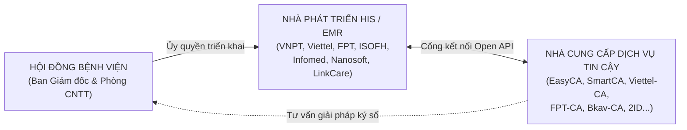

# Báo cáo Tổng quan: Các Phương thức Ký Xác nhận Bệnh nhân tại Cơ sở Y tế

> **Tài liệu nghiên cứu chiến lược:** Phục vụ công tác hoạch định sản phẩm, định giá và tư vấn giải pháp cho khối khách hàng bệnh viện của SoftDreams.  
> **Khung pháp lý tham chiếu:** Luật Giao dịch điện tử số 20/2023/QH15, Nghị định số 23/2025/NĐ-CP, Luật Khám bệnh, chữa bệnh số 15/2023/QH15, Luật An toàn thông tin mạng số 86/2015/QH13, Luật Bảo vệ dữ liệu cá nhân số 91/2025/QH15, Nghị định số 356/2025/NĐ-CP và **Thông tư số 13/2025/TT-BYT (Điều 3)**.

---

## 1. Khung Pháp lý Tham chiếu: Điều 3 Thông tư 13/2025/TT-BYT

Trong hồ sơ bệnh án điện tử (EMR), người bệnh hoặc người đại diện hợp pháp phải ký xác nhận nhiều loại biểu mẫu có ý nghĩa pháp lý và chuyên môn đặc biệt quan trọng: *Phiếu đồng ý phẫu thuật/thủ thuật, Cam kết sử dụng thuốc/vật tư kỹ thuật cao ngoài danh mục BHYT, Giấy từ chối điều trị, Bảng kê chi phí khám chữa bệnh...*

Theo **Điều 3 Thông tư 13/2025/TT-BYT**, Bộ Y tế quy định **3 nhóm phương thức** ký hoặc xác nhận điện tử được phép áp dụng:

```
┌────────────────────────────────────────────────────────────────────────────────────────┐
│  NHÓM 1: Sử dụng chữ ký điện tử hợp pháp (bao gồm chữ ký số của cá nhân người bệnh     │
│          theo quy định của pháp luật về giao dịch điện tử).                            │
├────────────────────────────────────────────────────────────────────────────────────────┤
│  NHÓM 2: Sử dụng các kỹ thuật sinh trắc học (như dấu vân tay, nhận diện khuôn mặt...). │
├────────────────────────────────────────────────────────────────────────────────────────┤
│  NHÓM 3: Sử dụng các hình thức xác nhận bằng phương tiện điện tử khác theo quy định tại │
│          khoản 4 Điều 22 Luật Giao dịch điện tử 2023 (như xác thực VNeID, OTP SMS,     │
│          hoặc ký trực tiếp trên thiết bị cảm ứng / bảng ký tại cơ sở y tế).            │
└────────────────────────────────────────────────────────────────────────────────────────┘
```

> **Nguyên tắc phân tích pháp lý & giá trị chứng cứ:**
> - Thông tư 13/2025/TT-BYT quy định 3 nhóm phương thức trên cơ sở bình đẳng theo pháp luật chuyên ngành y tế; **không quy định thứ bậc hành chính** (như "Cao nhất - Trung bình - Cơ bản").
> - Tuy nhiên, khi phát sinh tranh chấp hoặc khiếu nại chuyên môn trước cơ quan tài phán, **Điều 11 Luật Giao dịch điện tử số 20/2023/QH15** quy định giá trị chứng cứ của thông điệp dữ liệu được đánh giá căn cứ vào **độ tin cậy của cách thức khởi tạo, gửi, nhận hoặc lưu trữ; cách thức bảo đảm tính toàn vẹn; và cách thức xác định chủ thể thực hiện**.
> - Chữ ký số chuẩn PKI (thuộc Nhóm 1) có ưu thế vượt trội về cơ chế mật mã học (cặp khóa bí mật/công khai, hàm băm SHA-256 chống sửa đổi, chứng thư số do CA công cộng được cấp phép phát hành), mang lại **tính chống chối bỏ kỹ thuật và giá trị chứng minh cao**, mặc dù không có bất kỳ giải pháp nào được xem là "thắng kiện mặc định 100%" mà luôn phụ thuộc vào toàn bộ hồ sơ vụ việc theo pháp luật tố tụng `[Đã xác minh căn cứ pháp lý]`.

---

## 2. Bảng Ma trận So sánh Tổng thể các Giải pháp trên Thị trường

| Đơn vị / Giải pháp | Phương thức ký người bệnh | Phân nhóm theo TT 13/2025 | Cơ chế Chứng minh Danh tính & Toàn vẹn | Khả năng Ký từ xa | Mức độ Triển khai Thực tế tại Bệnh viện |
|---|---|:---:|---|:---:|---|
| **EasyCA (SoftDreams)** | **Chữ ký số PKI (Remote Signing / HSM)** | **Nhóm 1** | Cặp khóa cá nhân X.509 + Băm SHA-256 + Dấu thời gian TSA | ✅ Hỗ trợ eKYC từ xa | `[Chưa xác minh]` Đang nghiên cứu & thiết kế sản phẩm, chưa có dự án vận hành thực tế |
| **ISOFH / BV Xanh Pôn** | **Chữ ký số PKI qua VNeID** (hoặc xác nhận) | **Nhóm 1 / Nhóm 3** | Cấp CTS cá nhân qua CA đối tác + VNeID Mức 2 kích hoạt ký | ⚠️ Được (nếu có VNeID & mạng) | `[Đã xác minh]` Triển khai từ 22/05/2025; công bố phạm vi 100% nội trú & 3 PK ngoại trú |
| **2ID / 2Contract** | Quét chip CCCD (NFC) + Đối soát khuôn mặt | Nhóm 2 & Nhóm 3 | Đối soát sinh trắc 1:1 chip CCCD + Ký số niêm phong CTS BV | ❌ Cần quét thẻ tại quầy | `[Đã xác minh thầu HSM Từ Dũ]`; tính năng quét CCCD BN `[Do doanh nghiệp công bố]` |
| **Viettel HMS** | Ký cảm ứng trên Tablet / VNeID | Nhóm 3 | Ghi nhận nét vẽ kèm Audit Log; hoặc xác nhận qua VNeID | ❌ Ký tablet phải ở viện | `[Đã xác minh]` Triển khai phần mềm tại nhiều BV công; ký số PKI cho BN `[Chưa xác minh]` |
| **VNPT HIS** | Ký qua VNeID / Tablet / SmartCA | Nhóm 3 (hoặc Nhóm 1) | Xác thực qua VNeID; hoặc cấp SmartCA (nếu có tài khoản) | ⚠️ Phụ thuộc phương thức | `[Đã xác minh]` Triển khai HIS diện rộng; ký số PKI cho BN vãng lai `[Chưa xác minh]` |
| **FPT eHospital** | Xác thực qua mã OTP SMS / Zalo | Nhóm 3 | Ghi nhận số điện thoại tiếp nhận OTP và biên lai viễn thông | ⚠️ Gửi OTP qua mạng viễn thông | `[Đã xác minh HIS tại BV lớn]`; ký số PKI cho BN `[Chưa xác minh]` |
| **Ký tay Tablet (DentalFlow...)** | Vẽ chữ ký trên màn hình cảm ứng | Nhóm 3 | Lưu ảnh nét vẽ; hệ thống cao cấp lưu kèm tọa độ, Device ID | ❌ Bắt buộc tại cơ sở y tế | `[Đã xác minh DentalFlow nha khoa]`; phổ biến tại nhiều phòng khám & bệnh viện |

---

## 3. Bảng Đánh giá Toàn diện 13 Tiêu chí Xuyên suốt Thị trường

| STT | Tiêu chí Đánh giá | EasyCA (SoftDreams) | ISOFH (BV Xanh Pôn) | 2ID (BV Từ Dũ) | Viettel HMS | VNPT HIS | FPT eHospital | Ký tay Tablet (Phòng khám) |
|:---:|---|---|---|---|---|---|---|---|
| 1 | **Vai trò hệ sinh thái** | CA công cộng chuyên sâu | HIS/EMR Vendor | ISV / Tích hợp thẻ | HIS Vendor & CA | HIS Vendor & CA | HIS Vendor & CA | Module tiếp đón độc lập |
| 2 | **Phân nhóm TT 13/2025** | **Nhóm 1 (PKI)** | **Nhóm 1 / Nhóm 3** | **Nhóm 2 & 3** | **Nhóm 3 (Tablet/VNeID)** | **Nhóm 3 & 1** | **Nhóm 3 (OTP/eSign)** | **Nhóm 3 (Tablet)** |
| 3 | **Cấp CTS riêng người bệnh** | Có (Cá nhân) | Có (CTS SmartCA cá nhân) | Không (Dùng CTS BV) | Không (Dùng CTS BV) | Có thể (SmartCA cá nhân) | Không (Dùng CTS BV) | Không (Dùng CTS BV) |
| 4 | **Cơ chế xác thực người ký** | eKYC CCCD chip + Face | App VNeID Mức 2 | Đọc chip CCCD + Face | Tài khoản tiếp đón / VNeID | VNeID / SmartCA PIN | OTP qua SMS/Zalo | Nhân viên y tế đối soát mặt |
| 5 | **Bảo đảm toàn vẹn tài liệu** | Băm SHA-256 + Khóa PKI | Băm SHA-256 + Khóa PKI | Băm SHA-256 + CTS BV | Băm SHA-256 + CTS BV | Băm SHA-256 + CTS BV | Băm SHA-256 + CTS BV | Phụ thuộc cấu hình phần mềm |
| 6 | **Dấu thời gian chuẩn (TSA)** | Có hỗ trợ TSA | Có hỗ trợ TSA | Phụ thuộc cấu hình HSM | Phụ thuộc cấu hình HSM | Có hỗ trợ SmartCA | Phụ thuộc FPT eSign | Thường chỉ có timestamp CSDL |
| 7 | **Hỗ trợ Ký từ xa** | Toàn diện (Web/Mobile) | Có (App VNeID) | Không (Cần quầy đọc chip) | Không (Ký Tablet quầy) | Phụ thuộc phương thức | Có (Qua OTP SMS) | Không hỗ trợ |
| 8 | **Độ thân thiện tiếp đón** | Trung bình (cần eKYC) | Thấp-TB (cần smartphone) | Cao (Chạm thẻ 10-15s) | Rất cao (Vẽ tay 5-10s) | Cao (Tablet) / TB (VNeID) | Rất cao (Nhập OTP) | Cực kỳ cao (Thao tác tức thì) |
| 9 | **Rào cản thiết bị người dân** | Cần điện thoại/camera | Bắt buộc Smartphone + VNeID | Không cần điện thoại | Không cần thiết bị riêng | Tùy phương thức | Chỉ cần điện thoại cơ bản | Không cần thiết bị riêng |
| 10 | **Chi phí biến đổi (Lượt ký)** | Chi phí theo lượt ký PKI | Chi phí tích hợp VNeID | Chi phí khấu hao đầu đọc | Chi phí đầu tư máy tính bảng | Phí thuê bao / lượt ký | Phí viễn thông SMS/ZNS | Khấu hao thiết bị & bảo trì |
| 11 | **Tính trung lập HIS/EMR** | Trung lập (Open API) | Khép kín theo ISOFH | Độc lập (Phần cứng quầy) | Ưu tiên hệ sinh thái Viettel | Ưu tiên hệ sinh thái VNPT | Ưu tiên hệ sinh thái FPT | Độc lập theo phần mềm |
| 12 | **Giá trị chứng minh tố tụng** | Rất cao (PKI chuẩn) | Rất cao (PKI + VNeID) | Khá cao (Có Audit Log) | Trung bình (Phụ thuộc log) | Trung bình - Rất cao | Trung bình (Có log nhà mạng) | Thấp - Trung bình |
| 13 | **Tình trạng kiểm chứng** | `[Chưa xác minh dự án]` | `[Đã xác minh Xanh Pôn]` | `[Đã xác minh thầu Từ Dũ]` | `[Đã xác minh thầu công]` | `[Đã xác minh diện rộng]` | `[Đã xác minh HIS lớn]` | `[Đã xác minh diện rộng]` |

---

## 4. Phân tích Kỹ thuật & Nghiệp vụ 6 Phương thức Ký Hiện nay

### 4.1 Chữ ký Cảm ứng trên Tablet (Touch / Stylus Signature)
- **Bản chất:** Bệnh nhân vẽ chữ ký trên màn hình cảm ứng máy tính bảng. Mức độ an toàn chia làm hai cấp độ: cấp độ cơ bản chỉ xuất ảnh tĩnh (PNG/JPEG) chèn vào PDF; cấp độ nâng cao thu thập chuỗi tọa độ (X, Y), thời gian nét vẽ, Device ID, log nhân viên giám sát và ký số HSM của bệnh viện niêm phong.
- **Ưu thế:** Thao tác tức thì (5-10 giây), không gây ùn tắc quầy tiếp đón, người bệnh không cần thiết bị thông minh.
- **Hạn chế:** Không hỗ trợ ký từ xa; nếu xảy ra phủ nhận chữ ký, việc giám định tư pháp nét vẽ trên mặt kính cảm ứng phức tạp hơn so với chữ ký bút mực truyền thống; dữ liệu áp lực nét bút chỉ lấy được khi dùng bút cảm ứng lực chuyên dụng.

### 4.2 Kỹ thuật Sinh trắc học (Dấu vân tay điện tử tại quầy)
- **Bản chất:** Quét vân tay tại quầy để trích xuất chuỗi đặc trưng (Minutiae) đối soát với cơ sở dữ liệu.
- **Ưu thế:** Rất thuận tiện cho người cao tuổi, người không biết chữ; không yêu cầu sở hữu điện thoại thông minh.
- **Hạn chế:** Dấu vân tay chủ yếu là phương thức định danh; bắt buộc phải kết hợp với chữ ký số niêm phong của bệnh viện để bảo đảm tính toàn vẹn của hồ sơ bệnh án.

### 4.3 Xác thực qua mã OTP (SMS Brandname / Zalo ZNS)
- **Bản chất:** Hệ thống phát sinh chuỗi ký tự ngẫu nhiên dùng một lần gửi qua đường truyền viễn thông; bệnh nhân nhập mã để xác nhận chấp thuận giao dịch theo khoản 4 Điều 22 Luật GDĐT 2023.
- **Ưu thế:** Sử dụng được trên điện thoại phổ thông không cần kết nối internet.
- **Hạn chế:** Bệnh viện phải chịu chi phí viễn thông lũy kế liên tục; phụ thuộc vào chất lượng sóng di động tại các khu vực đặc thù (phòng chụp MRI, tầng hầm, phòng mổ); OTP chứng minh quyền tiếp cận số điện thoại, không tự động chứng minh ai là người thực sự bấm máy.

### 4.4 Xác nhận qua Ứng dụng VNeID (Liên kết Đề án 06)
- **Bản chất:** Hệ thống bệnh viện gửi yêu cầu xác nhận sang tài khoản định danh điện tử VNeID Mức 2 của công dân để kích hoạt xác nhận hoặc kích hoạt chữ ký số từ xa của CA đối tác.
- **Ưu thế:** Dữ liệu định danh được xác thực bởi Bộ Công An, có uy tín pháp lý cao nhất về nhận diện công dân.
- **Hạn chế:** Đòi hỏi người bệnh phải có điện thoại thông minh kết nối mạng và đã kích hoạt VNeID Mức 2 thành công; có thể phát sinh ma sát tại khoa cấp cứu hoặc người bệnh cao tuổi không dùng smartphone.

### 4.5 Quét Chip CCCD qua NFC + Đối soát Khuôn mặt (Mô hình 2ID / 2Contract)
- **Bản chất:** Thiết bị đọc chip ICAO trên thẻ CCCD vật lý tại quầy tiếp đón kết hợp camera đối soát khuôn mặt 1:1; sau đó người bệnh bấm nút xác nhận và hệ thống bệnh viện ký số niêm phong kèm gói dữ liệu bằng chứng.
- **Ưu thế:** Tận dụng thẻ CCCD gắn chip sẵn có của toàn dân, thao tác tại quầy nhanh chóng không phụ thuộc pin hay mạng của điện thoại người dân.
- **Hạn chế:** Bệnh viện phải đầu tư thiết bị phần cứng chuyên dụng tại từng quầy; không hỗ trợ luồng ký từ xa cho thân nhân ở xa.

### 4.6 Chữ ký số Chuẩn PKI cá nhân (Mô hình Đề xuất EasyCA)
- **Bản chất:** Người bệnh được cấp chứng thư số cá nhân lưu trữ trên hệ thống Remote Signing / HSM bảo mật; sử dụng khóa bí mật để ký số mã băm SHA-256 niêm phong tài liệu điện tử theo chuẩn PAdES và gắn nhãn thời gian TSA.
- **Ưu thế:** Thuộc **Nhóm 1 theo Thông tư 13/2025/TT-BYT**; giá trị pháp lý và khả năng chứng minh tố tụng cao theo Luật Giao dịch điện tử 2023; hỗ trợ linh hoạt cả ký tại viện và ký từ xa.
- **Thách thức:** Cần thiết kế quy trình cấp chứng thư số điện tử theo đúng **Nghị định số 23/2025/NĐ-CP (Điều 36, Điều 43 khoản 3)** sao cho thời gian thao tác nhanh nhất, không gây ách tắc luồng tiếp đón.

---

## 5. Vai trò của Nhóm Đối thủ Trung gian (HIS/EMR Vendors & System Integrators)

Trong thị trường y tế số, quyết định lựa chọn giải pháp chữ ký số của Bệnh viện chịu ảnh hưởng quyết định bởi **Nhà cung cấp phần mềm Quản lý Bệnh viện (HIS/EMR) hiện hữu**:



1. **Khả năng chi phối của nhà thầu HIS:** Bệnh viện rất e ngại việc chỉnh sửa hoặc thay thế phần mềm HIS/EMR đang vận hành liên tục 24/7. Nếu nhà cung cấp CA không phối hợp được với đơn vị phát triển HIS để mở cổng kết nối API, giải pháp ký số không thể triển khai trên thực tế.
2. **Chiến lược tiếp cận thị trường của EasyCA:**
   - **Tính trung lập (Vendor-agnostic):** EasyCA không phát triển phần mềm HIS cạnh tranh với các công ty CNTT y tế, do đó là đối tác tin cậy và không xung đột lợi ích đối với các đơn vị HIS độc lập (như Nanosoft, Infomed, LinkCare, ISOFH...).
   - **Cơ chế hợp tác chia sẻ doanh thu (Revenue Sharing):** Xây dựng bộ Open API chuẩn hóa kèm chính sách phân chia doanh thu lượt ký hấp dẫn để biến các công ty HIS thành kênh phân phối trực tiếp giải pháp EasyCA vào bệnh viện `[Nhận định chuyên môn / Đề xuất thương mại]`.

---

## 6. Danh mục Báo cáo Chi tiết Từng Giải pháp

1. [**`01-easyca-softdreams.md`**](01-easyca-softdreams.md) — Phân tích Kiến trúc Giải pháp EasyCA PKI theo Nghị định 23/2025/NĐ-CP
2. [**`02-2id-2contract.md`**](02-2id-2contract.md) — Đánh giá Giải pháp Quét chip CCCD 2ID / 2Contract tại BV Từ Dũ
3. [**`03-isofh-vneid.md`**](03-isofh-vneid.md) — Phân tích Giải pháp Ký số PKI qua VNeID của ISOFH tại BV Xanh Pôn
4. [**`04-viettel-hms.md`**](04-viettel-hms.md) — Đánh giá Hệ sinh thái Viettel HMS & Chữ ký số Viettel-CA
5. [**`05-vnpt-his.md`**](05-vnpt-his.md) — Đánh giá Hệ sinh thái VNPT HIS & Dịch vụ VNPT SmartCA
6. [**`06-fpt-ehospital.md`**](06-fpt-ehospital.md) — Phân tích Giải pháp Xác thực OTP & Nền tảng FPT eSign
7. [**`07-ky-tay-tablet.md`**](07-ky-tay-tablet.md) — Phân tích Kỹ thuật & Khung Pháp lý Mô hình Chữ ký Tablet Cảm ứng
8. [**`08-BAO-CAO-KIEM-CHUNG.md`**](08-BAO-CAO-KIEM-CHUNG.md) — Báo cáo Kiểm chứng Toàn diện & Đối chiếu Nguồn Dữ liệu
9. [**`00-INDEX.md`**](00-INDEX.md) — Mục lục & Cấu trúc Tiêu chuẩn 6 Phần của Bộ Tài liệu
