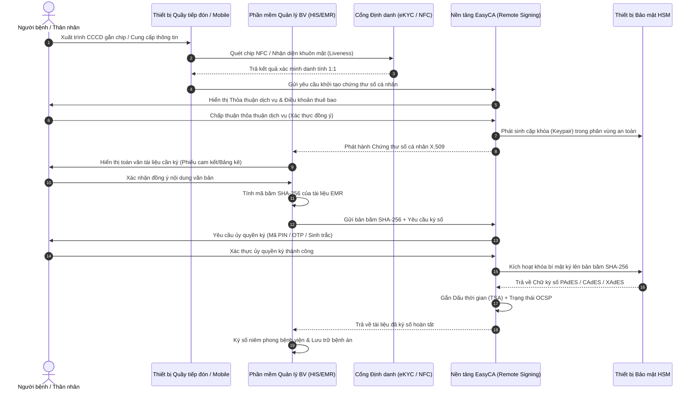

# EasyCA (SoftDreams) — Phân tích Kiến trúc Giải pháp Chữ ký số Bệnh nhân

---

## 1. Thông tin Doanh nghiệp & Năng lực Pháp lý CA Hiện hữu

- **Tên pháp nhân:** Công ty Cổ phần Đầu tư Công nghệ và Thương mại Softdreams `[Đã xác minh từ văn bản/nguồn chính thức]`.
- **Thương hiệu giải pháp:** EasyCA (Chữ ký số), EasyInvoice (Hóa đơn điện tử), EasyBooks (Kế toán), EasyExport...
- **Căn cứ pháp lý giấy phép hoạt động CA:**
  - *Giấy phép số 61/GP-BTTTT:* Do Bộ Thông tin và Truyền thông cấp ngày 21/02/2020, có giá trị đến ngày 20/02/2030, cấp phép cung cấp dịch vụ chứng thực chữ ký số công cộng `[Đã xác minh từ văn bản/nguồn chính thức]`.
  - *Giấy phép số 82/GP-BTTTT:* Do Bộ Thông tin và Truyền thông cấp ngày 14/03/2023, có giá trị đến ngày 13/03/2033, cấp phép cung cấp dịch vụ chứng thực chữ ký số công cộng theo mô hình ký số từ xa (Remote Signing) `[Đã xác minh từ văn bản/nguồn chính thức]`.
  - *Trạng thái trên danh bạ NEAC:* Đang duy trì hoạt động bình thường, hạ tầng khóa gốc kết nối với Root CA quốc gia do Trung tâm Chứng thực điện tử quốc gia (NEAC) quản lý `[Đã xác minh từ website NEAC]`.
- **Phân định rõ hai phạm vi năng lực:**
  1. *Năng lực dịch vụ tin cậy hiện hữu:* SoftDreams là một CA công cộng hợp pháp có đầy đủ hạ tầng ký số USB Token, HSM và Remote Signing tuân thủ các quy chuẩn kỹ thuật quốc gia `[Đã xác minh]`.
  2. *Giải pháp ký số chuyên biệt cho bệnh nhân tại bệnh viện:* Đây là **mô hình sản phẩm đang trong giai đoạn nghiên cứu, thiết kế kiến trúc và phát triển (Product R&D / Design)**; SoftDreams chưa công bố dự án triển khai ký số bệnh nhân chính thức nào đã nghiệm thu và vận hành đại trà tại bệnh viện `[Chưa xác minh dự án thực tế]`.

---

## 2. Kiến trúc Kỹ thuật Đề xuất cho Bài toán Ký số Bệnh nhân

Để giải quyết bài toán ký xác nhận hồ sơ bệnh án điện tử (EMR) cho người bệnh và thân nhân theo chuẩn PKI, kiến trúc giải pháp đề xuất bao gồm các phân hệ kỹ thuật sau:

### 2.1 Bản chất Kỹ thuật của Quy trình Mật mã học PKI
1. **Hàm băm SHA-256 (Mật mã một chiều):**
   - Hàm băm SHA-256 nhận đầu vào là toàn bộ tệp dữ liệu văn bản y tế (PDF, XML hoặc chuỗi JSON cấu trúc) và tạo ra một bản tóm lược dữ liệu (Message Digest) duy nhất có độ dài cố định 256-bit.
   - *Lưu ý kỹ thuật chính xác:* Hàm băm **không có chức năng mã hóa bảo mật nội dung** (không thể giải mã ngược lại ra văn bản ban đầu). Vai trò cốt lõi của hàm băm là **bảo đảm tính toàn vẹn (Integrity)**: chỉ cần thay đổi 1 ký tự trong bệnh án, bản băm SHA-256 mới sẽ hoàn toàn khác biệt so với bản băm ban đầu.
2. **Cặp khóa Mật mã học Bất đối xứng (Private / Public Key):**
   - Khóa bí mật (Private Key) được tạo lập và lưu giữ an toàn tuyệt đối bên trong phân vùng của thiết bị bảo mật phần cứng HSM (đạt chuẩn FIPS 140-2 Level 3 / Common Criteria EAL4+). Khóa bí mật chỉ được kích hoạt khi nhận được lệnh xác thực ủy quyền trực tiếp từ người bệnh.
   - Phép ký số thực chất là thao tác dùng Khóa bí mật để mã hóa bản tóm lược SHA-256.
   - Khóa công khai (Public Key) được đóng gói trong Chứng thư số cá nhân chuẩn X.509 v3 do EasyCA ký phát hành, cho phép bất kỳ cơ quan tài phán hoặc bên thứ ba nào cũng có thể kiểm tra tính hợp lệ của chữ ký mà không cần tiếp cận khóa bí mật.
3. **Phân biệt Dấu thời gian chuẩn (TSA - Time Stamping Authority):**
   - Dịch vụ TSA cấp dấu thời gian độc lập được ký số bởi hệ thống phát hành dấu thời gian đạt chuẩn RFC 3161, chứng thực rằng chữ ký và thông điệp dữ liệu đã tồn tại chính xác tại thời điểm được ghi nhận.
   - *Lưu ý chuyên môn:* Dấu thời gian TSA chứng minh thời điểm dữ liệu tồn tại, **không xác nhận danh tính hay ý chí của người ký**.
4. **Định dạng Ký số Tài liệu Bệnh án:**
   - Đối với tài liệu định dạng PDF (bản in bệnh án, phiếu cam kết): Áp dụng chuẩn **PAdES (PDF Advanced Electronic Signatures)** tích hợp đầy đủ thông tin kiểm tra hiệu lực chứng thư số (LTV - Long Term Validation) qua giao thức OCSP/CRL.
   - Đối với dữ liệu bệnh án cấu trúc theo định dạng XML hoặc JSON (HL7 CDA / FHIR): Cần sử dụng chuẩn chữ ký điện tử tương ứng như **XAdES** (cho XML) hoặc **JAdES** (cho JSON). Không thể dùng chuẩn PAdES để ký trực tiếp trên dữ liệu thô phi PDF.

### 2.2 Cơ chế Cấp phát Chứng thư số theo Đợt điều trị (Transactional Certificate Design)
- **Bản chất pháp lý & thiết kế:** Trong khuôn khổ Nghị định số 23/2025/NĐ-CP (Điều 7), pháp luật quy định thời hạn tối đa của chứng thư chữ ký số là 03 năm nhưng không cấm phát hành chứng thư có thời hạn ngắn hơn.
- SoftDreams đề xuất phương án **thiết kế sản phẩm và mô hình thương mại**: Cấp chứng thư số cá nhân có thời hạn hiệu lực phù hợp với một đợt khám chữa bệnh (vài giờ đến vài ngày). Đây là giải pháp kiến trúc tối ưu trải nghiệm và chi phí cho bệnh viện, **không phải là một loại chứng thư mang tên "Transactional Certificate" được pháp luật định danh riêng** `[Nhận định chuyên môn]`.
- Sau khi bệnh nhân xuất viện hoặc kết thúc đợt khám, chứng thư số hết hạn hoặc được thu hồi; chữ ký số trên các hồ sơ đã ký vẫn duy trì giá trị pháp lý vĩnh viễn nhờ dấu thời gian TSA và cơ chế xác thực chứng thư LTV.

---

## 3. Căn cứ Pháp lý & Đánh giá Tuân thủ Chuyên sâu

### 3.1 Phân nhóm theo Thông tư số 13/2025/TT-BYT (Điều 3)
- Giải pháp chữ ký số cá nhân của EasyCA thuộc **Nhóm 1: Sử dụng chữ ký điện tử hợp pháp** theo quy định tại điểm a khoản 1 Điều 3 Thông tư 13/2025/TT-BYT `[Đã xác minh căn cứ pháp lý]`.
- *Nguyên tắc đánh giá:* Thông tư 13/2025/TT-BYT quy định 3 nhóm phương thức bình đẳng theo pháp luật chuyên ngành y tế. Sự vượt trội của Nhóm 1 nằm ở **cơ chế kỹ thuật mật mã học bảo đảm tính toàn vẹn và xác thực chủ thể**, không phải do Thông tư 13 quy định thứ bậc hành chính.

### 3.2 Tuân thủ Luật Giao dịch điện tử số 20/2023/QH15
- **Khoản 11, 12 Điều 3:** Chữ ký số là chữ ký điện tử sử dụng thuật toán khóa bất đối xứng, đáp ứng điều kiện kiểm tra tính toàn vẹn và xác định chủ thể.
- **Điều 22 & Khoản 2 Điều 23:** Chữ ký số của cá nhân người bệnh do CA công cộng cấp, khi được triển khai đúng quy định pháp luật và người ký kiểm soát phương tiện tạo chữ ký tại thời điểm ký, **có giá trị pháp lý tương đương chữ ký tay của cá nhân đó**.
- **Điều 11 (Giá trị chứng cứ của thông điệp dữ liệu):**
  - Giá trị chứng cứ của hồ sơ bệnh án điện tử có chữ ký số PKI được đánh giá căn cứ vào độ tin cậy của cách thức khởi tạo, lưu trữ, gửi nhận, bảo đảm tính toàn vẹn và xác định chủ thể.
  - *Hiệu chỉnh quan trọng:* **Chữ ký số PKI không mặc nhiên giúp bệnh viện "thắng kiện 100%" hay có "giá trị tuyệt đối".** Khái niệm "tính chống chối bỏ (Non-repudiation)" là đặc tính kỹ thuật mật mã học; trước cơ quan tố tụng, Tòa án vẫn xem xét toàn diện chứng cứ: người bệnh có thực sự tự thực hiện ủy quyền ký hay không, có bị lừa dối, cưỡng ép hoặc mất năng lực nhận thức hay không `[Nhận định pháp lý chuẩn xác]`.

### 3.3 Tuân thủ Nghị định số 23/2025/NĐ-CP
- **Điều 36 (Phát hành chứng thư chữ ký số công cộng bằng phương thức điện tử):**
  - EasyCA phải ban hành, công khai quy trình cấp chứng thư số eKYC; xây dựng giải pháp công nghệ đáp ứng tiêu chuẩn định danh, quản lý rủi ro và thu thập sự chấp thuận rõ ràng của thuê bao.
- **Khoản 3 Điều 43 (Lưu trữ thông tin):**
  - Tổ chức cung cấp dịch vụ chứng thực chữ ký số công cộng có trách nhiệm lưu trữ đầy đủ các thông tin liên quan đến hoạt động cung cấp dịch vụ của thuê bao trong suốt thời gian hiệu lực và **tối thiểu là 05 năm sau khi chứng thư chữ ký số hết hiệu lực hoặc bị thu hồi** `[Đã xác minh chính xác từ văn bản gốc NĐ 23/2025/NĐ-CP]`.
- **Điều 37 (Quản lý khóa bí mật):**
  - Trong mô hình Remote Signing, khóa bí mật của người bệnh lưu trữ tại HSM phải bảo đảm nguyên tắc: chỉ có duy nhất người bệnh (hoặc người đại diện hợp pháp) mới có quyền kiểm soát và kích hoạt khóa; EasyCA không được phép tự ý thay mặt thuê bao ký số.

### 3.4 Tuân thủ Luật Bảo vệ dữ liệu cá nhân số 91/2025/QH15 & Nghị định số 356/2025/NĐ-CP (Hiệu lực 01/01/2026)
- **Dữ liệu cá nhân nhạy cảm:** Dữ liệu sức khỏe/bệnh án (khoản 1 Điều 26) và dữ liệu sinh trắc học (Điều 31) là dữ liệu nhạy cảm được bảo vệ nghiêm ngặt.
- **Phân định vai trò xử lý dữ liệu:**
  - *Bệnh viện:* Đóng vai trò là **Bên kiểm soát dữ liệu (Data Controller)** đối với hồ sơ bệnh án và thông tin sức khỏe của người bệnh.
  - *SoftDreams (EasyCA):* Đóng vai trò là **Bên kiểm soát dữ liệu (Data Controller)** đối với hồ sơ thuê bao chữ ký số (theo nghĩa vụ của CA công cộng), đồng thời là **Bên xử lý dữ liệu (Data Processor)** khi thực hiện các phép toán ký số tài liệu bệnh án theo hợp đồng dịch vụ ký kết với bệnh viện.
  - Bệnh viện và SoftDreams phải thực hiện Đánh giá tác động xử lý dữ liệu cá nhân (DPIA) theo quy định.

### 3.5 Tuân thủ Luật Khám bệnh, chữa bệnh số 15/2023/QH15
- **Quyền đồng ý và người đại diện:** Việc ký phiếu cam kết điều trị, phẫu thuật phải bảo đảm người bệnh hoặc người đại diện hợp pháp được giải thích đầy đủ và tự nguyện thể hiện ý chí (Điều 15, Điều 16).
- Đối với bệnh nhân chưa thành niên, người mất hoặc hạn chế năng lực hành vi dân sự, hoặc trong tình trạng cấp cứu bất tỉnh: Quy trình giải pháp phải thiết kế luồng xác minh quyền đại diện của thân nhân trước khi tạo và kích hoạt chữ ký số.

---

## 4. Hiện trạng Khách hàng & Triển khai Thực tế

- **Khách hàng Chữ ký số EasyCA:** Hơn 100.000 doanh nghiệp và tổ chức trên toàn quốc đang sử dụng EasyCA cho các nghiệp vụ kê khai thuế, hải quan, bảo hiểm xã hội và hóa đơn điện tử `[Do doanh nghiệp công bố]`.
- **Hiện trạng tại Khối Y tế:**
  - SoftDreams chưa có dự án triển khai ký số bệnh nhân diện rộng đã nghiệm thu chính thức tại bệnh viện `[Đã xác minh]`.
  - Giải pháp ký số bệnh nhân hiện đang ở mức độ xây dựng kiến trúc, chuẩn bị tài liệu kỹ thuật API và tìm kiếm cơ sở y tế đối tác để triển khai thử nghiệm (Proof of Concept - PoC) `[Chưa xác minh mức độ vận hành lâm sàng]`.

---

## 5. Bảng Đánh giá Tiêu chuẩn 13 Tiêu chí: EasyCA vs Toàn cảnh Thị trường

| STT | Tiêu chí Đánh giá | Hồ sơ Năng lực Hiện hữu của EasyCA | Đánh giá Khách quan & Rào cản Thực tế |
|:---:|---|---|---|
| 1 | **Vai trò trong hệ sinh thái** | Tổ chức cung cấp dịch vụ chứng thực chữ ký số công cộng (CA công cộng) | Thuần túy là CA, không sở hữu hệ thống HIS/EMR bệnh viện |
| 2 | **Sản phẩm & giải pháp** | EasyCA Token, EasyCA HSM, EasyCA Remote Signing | Bộ API tích hợp chuyên biệt cho y tế đang trong giai đoạn R&D |
| 3 | **Phương thức ký người bệnh** | Chữ ký số PKI cá nhân (Remote Signing / Cloud HSM) | Thuộc Nhóm 1 TT 13/2025; đòi hỏi quy trình eKYC tại quầy |
| 4 | **Đối tượng ký chính** | Thiết kế phục vụ Người bệnh & Thân nhân ký hồ sơ EMR | Chưa có dữ liệu thực nghiệm về tỷ lệ người bệnh tự thao tác |
| 5 | **Khả năng tích hợp HIS/EMR** | Sẵn sàng mở cổng Open API cho mọi nhà thầu phần mềm | Phụ thuộc vào thiện chí hợp tác mở cổng của các nhà thầu HIS |
| 6 | **Khả năng Remote Signing** | `[Đã xác minh]` Có Giấy phép số 82/GP-BTTTT của Bộ TT&TT | Đã sẵn sàng về mặt hạ tầng công nghệ lõi |
| 7 | **Khả năng sử dụng HSM** | `[Đã xác minh]` Hạ tầng HSM chuyên dụng đạt chuẩn quốc tế | Đảm bảo an toàn khóa bí mật theo quy định pháp luật |
| 8 | **Khả năng xác thực sinh trắc** | Thiết kế tích hợp xác thực khuôn mặt (Liveness) & chip CCCD | Cần đối tác kết nối dữ liệu dân cư hoặc thiết bị đọc thẻ |
| 9 | **Bằng chứng triển khai tại BV** | `[Chưa xác minh]` Chưa có dự án bệnh viện vận hành thực tế | Là bất lợi lớn nhất khi tham gia đấu thầu hoặc tư vấn |
| 10 | **Lợi thế cạnh tranh cốt lõi** | Tính trung lập cao; chuẩn pháp lý Nhóm 1 PKI cao nhất | Không cạnh tranh thị phần phần mềm quản lý bệnh viện với HIS |
| 11 | **Hạn chế cốt lõi** | Chưa có hệ sinh thái phần mềm bệnh viện đi kèm | Rào cản ma sát tiếp đón ban đầu nếu quy trình eKYC quá dài |
| 12 | **Định vị Cạnh tranh** | Giải pháp bổ trợ tin cậy chuyên sâu cho các thủ tục rủi ro cao | Cần chứng minh hiệu quả kinh tế TCO so với ký Tablet / OTP |
| 13 | **Những điểm cần kiểm chứng qua PoC** | - Tỷ lệ eKYC thành công trong 60 giây - Mức độ chấp nhận chi phí lượt ký của bệnh viện | Cần dự án thí điểm thực tế tại 01 bệnh viện đa khoa để đo đếm |

---

## 6. Chiến lược Sản phẩm, Hợp tác Thương mại & Lộ trình PoC

### 6.1 Chiến lược Định vị Trung lập (Vendor-Agnostic Trust Service)
- EasyCA không phát triển phần mềm HIS/EMR để cạnh tranh với các công ty CNTT y tế, mà định vị là **Nền tảng Dịch vụ Tin cậy Chuyên dụng (Dedicated Trust Infrastructure)** kết nối linh hoạt qua Open API.
- *Lưu ý chiến lược:* Tính trung lập là một lợi thế lý thuyết, nhưng **không thể mặc định các bên HIS sẽ vui vẻ hợp tác**. Để biến giả thuyết này thành hiện thực, SoftDreams cần xây dựng chính sách thương mại chia sẻ doanh thu lượt ký (Revenue Sharing) hấp dẫn để các đơn vị HIS coi EasyCA là đối tác gia tăng giá trị thay vì đối thủ cạnh tranh `[Nhận định chuyên môn]`.

### 6.2 Mô hình Kiến trúc Phân tầng Rủi ro (Risk-Based Tiering)
Không cố gắng thay thế toàn bộ chữ ký giấy hoặc chữ ký Tablet trong mọi quy trình tiếp đón hành chính thông thường. EasyCA nên tập trung vào phân khúc tài liệu có rủi ro pháp lý và tài chính cao:
1. **Phân tầng Cam kết Rủi ro Cao (High Risk):** Phiếu đồng ý phẫu thuật/thủ thuật xâm lấn, Cam kết sử dụng thuốc/vật tư ngoài danh mục BHYT giá trị lớn, Giấy từ chối điều trị... ➔ **Bắt buộc áp dụng Chữ ký số PKI EasyCA (Nhóm 1)**.
2. **Phân tầng Tiếp đón Thông thường (Low Risk):** Phiếu khám ngoại trú, bảng kê chi phí nhỏ... ➔ Bệnh viện có thể tiếp tục sử dụng ký cảm ứng Tablet (Nhóm 3) để duy trì tốc độ.

### 6.3 Các Chỉ tiêu Cần Đo lường trong Thử nghiệm Lâm sàng (PoC Metrics)
Khi triển khai thử nghiệm thực tế tại một bệnh viện đối tác, EasyCA cần thu thập dữ liệu khách quan để chứng minh năng lực:
1. *Thời gian thao tác trung bình (Average Onboarding Time):* Mục tiêu hoàn thành eKYC và cấp chứng thư dưới 60 giây.
2. *Tỷ lệ giao dịch ký thành công (Signing Success Rate):* Mục tiêu đạt trên 95% ở lần thử đầu tiên.
3. *Tỷ lệ người bệnh cần hỗ trợ (Assisted Rate):* Phân loại theo nhóm tuổi (dưới 40, 40-60, trên 60).
4. *Chi phí bình quân trên mỗi hồ sơ bệnh án hoàn chỉnh (Cost per Encouter).*

---

## 7. Nguồn Tham khảo & Bằng chứng Xác thực
1. Trung tâm Chứng thực điện tử quốc gia (NEAC) — Danh bạ các tổ chức cung cấp dịch vụ chứng thực chữ ký số công cộng được cấp phép (`neac.gov.vn`).
2. Giấy phép số 61/GP-BTTTT ngày 21/02/2020 và Giấy phép số 82/GP-BTTTT ngày 14/03/2023 của Bộ Thông tin và Truyền thông.
3. Luật Giao dịch điện tử số 20/2023/QH15.
4. Nghị định số 23/2025/NĐ-CP ngày 21/02/2025 của Chính phủ quy định về chữ ký điện tử và dịch vụ tin cậy (Điều 7, Điều 36, Điều 37, Điều 43).
5. Luật Bảo vệ dữ liệu cá nhân số 91/2025/QH15 và Nghị định số 356/2025/NĐ-CP.
6. Luật Khám bệnh, chữa bệnh số 15/2023/QH15.
7. Thông tư số 13/2025/TT-BYT ngày 30/06/2025 của Bộ Y tế hướng dẫn triển khai hồ sơ bệnh án điện tử (Điều 3).
