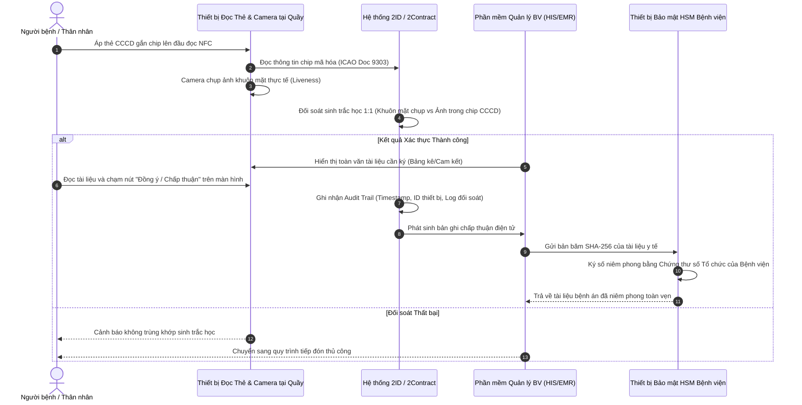

# 2ID / 2Contract — Mô hình Quét Chip CCCD & Xác thực Sinh trắc học tại Cơ sở Y tế

---

## 1. Thông tin Doanh nghiệp & Vị thế trong Chuỗi Cung ứng

- **Tên pháp nhân:** Công ty Cổ phần 2ID (Tên quốc tế: 2ID JOINT STOCK COMPANY) `[Đã xác minh từ CSDL Đăng ký Doanh nghiệp]`.
  - *Mã số thuế:* 0110199564.
  - *Người đại diện theo pháp luật:* Lưu Phúc Thọ.
  - *Địa chỉ trụ sở:* Số 21, ngõ 112 Ngọc Khánh, Phường Giảng Võ, Quận Ba Đình, Hà Nội.
- **Sản phẩm & Giải pháp cốt lõi:**
  - Nền tảng ký kết và quản lý tài liệu điện tử **2Contract**.
  - Giải pháp đọc và xác thực thẻ Căn cước công dân gắn chip **2IDCheck** (hỗ trợ eKYC, nhận diện ký tự quang học OCR, đọc chip NFC chuẩn ICAO Doc 9303 và đối soát sinh trắc học khuôn mặt).
- **Phân định rõ vai trò trong chuỗi cung ứng:**
  - **2ID KHÔNG PHẢI là Tổ chức cung cấp dịch vụ chứng thực chữ ký số công cộng (CA công cộng):** Tra cứu danh bạ chính thức của Trung tâm Chứng thực điện tử quốc gia (NEAC) xác nhận 2ID không có tên trong danh sách các CA công cộng được Bộ TT&TT cấp phép `[Đã xác minh từ nguồn chính thức NEAC]`.
  - **Vai trò thực tế:** 2ID đóng vai trò là **Nhà phát triển giải pháp phần mềm độc lập (ISV)** và **Nhà tích hợp hệ thống (System Integrator)**, chuyên cung cấp lớp ứng dụng ký kết, thiết bị phần cứng đọc thẻ CCCD và tích hợp thiết bị bảo mật HSM của các hãng phần cứng/CA đối tác vào phần mềm bệnh viện.

---

## 2. Sản phẩm & Cơ chế Công nghệ trong Bệnh viện

Quy trình ký xác nhận của bệnh nhân trong giải pháp của 2ID được cấu trúc thành chuỗi 5 bước công nghệ tách biệt:

### 2.1 Bóc tách Bản chất Kỹ thuật 5 Bước Thực hiện
1. **Bước 1 — Định danh chủ thể (Identity Verification):** Đầu đọc chuyên dụng tại quầy tiếp đón đọc dữ liệu từ chip thẻ CCCD qua giao tiếp trường gần NFC tuân theo tiêu chuẩn quốc tế ICAO Doc 9303 (trích xuất họ tên, số định danh cá nhân, ngày sinh, đặc điểm nhận dạng và ảnh chân dung gốc do Bộ Công An mã hóa trong chip).
2. **Bước 2 — Xác thực danh tính sinh trắc học (Biometric Authentication):** Camera chuyên dụng chụp khuôn mặt trực tiếp của người bệnh tại quầy (có thuật toán phát hiện người thật - Liveness Detection để chống giả mạo bằng ảnh chụp/video) và thực hiện đối soát 1:1 với ảnh chân dung số lưu trong chip CCCD.
3. **Bước 3 — Ghi nhận sự chấp thuận giao dịch (Consent Confirmation):**
   - Sau khi đối soát khuôn mặt thành công, màn hình hiển thị nội dung tài liệu (bản cam kết hoặc bảng kê chi phí).
   - Người bệnh chạm vào nút "Xác nhận đồng ý" trên màn hình cảm ứng của thiết bị tiếp đón.
   - *Phân tích pháp lý quan trọng:* Thao tác bấm nút xác nhận này là **hành vi thể hiện sự chấp thuận bằng phương tiện điện tử** theo quy định tại khoản 4 Điều 22 Luật Giao dịch điện tử 2023.
4. **Bước 4 — Niêm phong toàn vẹn tài liệu (Document Sealing):**
   - Sau khi ghi nhận sự chấp thuận của bệnh nhân, hệ thống HIS/EMR của bệnh viện kích hoạt thiết bị HSM để ký số lên thông điệp dữ liệu.
   - **Chủ thể ký số ở đây là Pháp nhân Bệnh viện (sử dụng Chứng thư số Tổ chức của Bệnh viện)**, hoàn toàn KHÔNG PHẢI chữ ký số cá nhân của bệnh nhân (bệnh nhân không được cấp chứng thư số riêng).
5. **Bước 5 — Lưu vết bằng chứng điện tử (Audit Trail):**
   - Hệ thống 2Contract đóng gói toàn bộ gói dữ liệu kiểm toán gồm: Dữ liệu đọc từ chip CCCD, kết quả đối soát sinh trắc học khuôn mặt, dấu thời gian, thông tin thiết bị tiếp đón, ID tài khoản nhân viên y tế giám sát và mã băm SHA-256 của tài liệu y tế để lưu trữ vào cơ sở dữ liệu.

---

## 3. Căn cứ Pháp lý & Đánh giá Tuân thủ

- **Phân nhóm chính xác theo Điều 3 Thông tư số 13/2025/TT-BYT:**
  - *Kỹ thuật đối soát khuôn mặt:* Đóng vai trò là phương tiện **xác thực danh tính chủ thể** dựa trên kỹ thuật sinh trắc học (thuộc phạm vi kỹ thuật Nhóm 2).
  - *Hành vi chấp thuận tài liệu:* Người bệnh bấm nút xác nhận trên màn hình thiết bị, thuộc **Nhóm 3: Sử dụng các hình thức xác nhận bằng phương tiện điện tử khác** theo quy định tại khoản 4 Điều 22 Luật Giao dịch điện tử số 20/2023/QH15.
  - *Chữ ký số niêm phong:* Là chữ ký số của cơ sở khám chữa bệnh (Nhóm 1 đối với pháp nhân cơ sở y tế), **không đồng nghĩa với việc bệnh nhân đã ký số PKI cá nhân**.
- **Căn cứ Luật Giao dịch điện tử số 20/2023/QH15:**
  - *Điều 11 (Giá trị chứng cứ của thông điệp dữ liệu):* Giá trị chứng cứ của tài liệu được ký theo mô hình 2ID dựa trên tính hoàn chỉnh của chuỗi nhật ký kiểm toán (Audit Trail) kết hợp với chữ ký số niêm phong của bệnh viện. Nếu cơ sở y tế xuất trình được đầy đủ bằng chứng kỹ thuật chứng minh chính người bệnh đã đứng trước camera đối soát và bấm nút chấp thuận, tài liệu có giá trị chứng minh pháp lý vững chắc trước Tòa án.
  - *Điều 22 khoản 4 & Điều 23:* Hình thức xác nhận điện tử này có giá trị ràng buộc trách nhiệm dân sự giữa bệnh nhân và bệnh viện trong thỏa thuận khám chữa bệnh, dù không thuộc trường hợp chữ ký số cá nhân tương đương chữ ký tay theo khoản 2 Điều 23.
- **Tuân thủ Luật Bảo vệ dữ liệu cá nhân số 91/2025/QH15 & Nghị định số 356/2025/NĐ-CP:**
  - Hình ảnh khuôn mặt trích xuất từ chip CCCD và ảnh chụp camera tại quầy là **dữ liệu cá nhân nhạy cảm** (Điều 31 Luật 91/2025/QH15).
  - 2ID và Bệnh viện phải bảo đảm: Dữ liệu khuôn mặt chỉ được xử lý cho mục đích đối soát xác thực danh tính tại thời điểm giao dịch, không được tự ý lưu trữ trái phép hoặc chia sẻ cho bên thứ ba khi chưa có sự đồng ý của chủ thể dữ liệu.

---

## 4. Khách hàng & Triển khai Thực tế: Đánh giá Tính xác thực của Bằng chứng

- **Kiểm chứng thông tin đấu thầu tại Bệnh viện Từ Dũ:**
  - *Tên gói thầu:* Trang bị chữ ký số HSM triển khai hồ sơ bệnh án điện tử `[Đã xác minh từ Hệ thống Mạng đấu thầu Quốc gia]`.
  - *Bên mời thầu:* Bệnh viện Từ Dũ.
  - *Nhà thầu trúng thầu:* Công ty Cổ phần 2ID.
  - *Giá trúng thầu:* 128.521.600 VND (Một trăm hai mươi tám triệu năm trăm hai mươi mốt nghìn sáu trăm đồng). Thời gian thực hiện hợp đồng: 24 tháng.
  - **Lưu ý kiểm chứng quan trọng:** Gói thầu này chỉ chứng minh 2ID trúng thầu cung cấp thiết bị và bản quyền phần mềm chữ ký số HSM phục vụ ký số EMR của bệnh viện. **Không thể sử dụng kết quả trúng thầu HSM này để khẳng định 2ID đã triển khai hoàn tất quy trình quét CCCD và đối soát khuôn mặt cho toàn bộ bệnh nhân tại Bệnh viện Từ Dũ.**
- **Mức độ vận hành thực tế giải pháp quét CCCD cho bệnh nhân:**
  - Tính năng quét chip CCCD và đối soát khuôn mặt bệnh nhân được 2ID công bố và giới thiệu tại một số sự kiện chuyển đổi số y tế `[Do doanh nghiệp công bố]`.
  - Các thông tin báo chí về việc áp dụng tại Bệnh viện Thanh Nhàn hay Bệnh viện Ung Bướu Hà Nội chủ yếu là các hoạt động thí điểm hoặc tiếp đón ban đầu, hiện chưa có tài liệu công bố chính thức về việc thay thế hoàn toàn 100% chữ ký bệnh nhân nội trú bằng giải pháp này `[Có nguồn tham khảo thứ cấp / Chưa xác minh mức độ vận hành lâm sàng]`.

---

## 5. Bảng Đánh giá Tiêu chuẩn 13 Tiêu chí & Khả năng Cạnh tranh vs EasyCA

| STT | Tiêu chí Đánh giá | Hồ sơ Giải pháp 2ID (2Contract / 2IDCheck) | Hồ sơ Đề xuất EasyCA (SoftDreams) |
|:---:|---|---|---|
| 1 | **Vai trò trong hệ sinh thái** | Nhà phát triển phần mềm độc lập (ISV) & Tích hợp thiết bị định danh | Tổ chức cung cấp dịch vụ chứng thực chữ ký số công cộng (CA công cộng) |
| 2 | **Sản phẩm & giải pháp** | 2Contract (E-Contract), 2IDCheck (Đọc chip CCCD/eKYC) | EasyCA HSM, EasyCA Remote Signing, Cổng ký số bệnh nhân |
| 3 | **Phương thức ký người bệnh** | Quét chip NFC + Chạm nút xác nhận + HSM Bệnh viện niêm phong | Chữ ký số PKI cá nhân (Remote Signing / HSM) |
| 4 | **Đối tượng ký chính** | Người bệnh có mặt trực tiếp tại quầy tiếp đón bệnh viện | Thiết kế phục vụ cả Người bệnh trực tiếp và Thân nhân ký từ xa |
| 5 | **Khả năng tích hợp HIS/EMR** | Tích hợp tốt với các HIS nhờ vai trò là nhà tích hợp phần cứng | Cung cấp Open API chuẩn hóa, độc lập và trung lập với mọi HIS |
| 6 | **Khả năng Remote Signing** | Không tự cung cấp dịch vụ CA; tích hợp CA đối tác nếu cần | `[Đã xác minh]` Có Giấy phép số 82/GP-BTTTT về Remote Signing |
| 7 | **Khả năng sử dụng HSM** | `[Đã xác minh]` Từng trúng thầu cung cấp giải pháp HSM | `[Đã xác minh]` Sở hữu hạ tầng HSM chuyên dụng đạt chuẩn quốc tế |
| 8 | **Khả năng xác thực sinh trắc** | Rất mạnh: Đọc chip ICAO Doc 9303 và đối soát khuôn mặt 1:1 | Thiết kế tích hợp eKYC (Face Liveness & OCR CCCD) |
| 9 | **Bằng chứng triển khai tại BV** | `[Đã xác minh thầu HSM Từ Dũ]`; tính năng quét CCCD BN `[Chưa xác minh diện rộng]` | `[Chưa xác minh]` Chưa có dự án bệnh viện vận hành chính thức |
| 10 | **Lợi thế cạnh tranh nổi bật** | Thao tác tại quầy cực kỳ nhanh (10-15s), tận dụng thẻ CCCD vật lý | Đạt chuẩn Nhóm 1 PKI cá nhân, hỗ trợ ký từ xa toàn diện |
| 11 | **Hạn chế cốt lõi** | Không hỗ trợ ký từ xa cho thân nhân; BV phải đầu tư đầu đọc quầy | Bệnh nhân cần thao tác eKYC; chưa có phần cứng tiếp đón sẵn |
| 12 | **Mức độ đe dọa với EasyCA** | **Cao tại phân khúc quầy tiếp đón trực tiếp:** 2ID giải quyết rất tốt bài toán ngoại trú | **Ưu thế tại phân khúc nội trú & ký từ xa:** EasyCA vượt trội |
| 13 | **Những điểm chưa xác minh** | Tỷ lệ bệnh viện vận hành thường quy luồng đối soát khuôn mặt cho người bệnh | Mức độ bệnh viện chấp nhận chi phí đầu đọc chuyên dụng |

### Phân tích Chiến lược Cạnh tranh của EasyCA:
1. **Khắc phục điểm yếu "Ký từ xa":** Điểm hạn chế lớn nhất của mô hình 2ID là bắt buộc người ký phải có mặt trực tiếp tại quầy tiếp đón để áp thẻ CCCD vào đầu đọc NFC. Đối với các tình huống bệnh nhân điều trị nội trú tại giường bệnh, hoặc thân nhân ở xa cần ký cam kết phẫu thuật khẩn cấp, mô hình 2ID không thể đáp ứng. EasyCA có lợi thế vượt trội nhờ khả năng gửi đường link ký số từ xa qua tin nhắn/ứng dụng với quy trình eKYC trực tuyến.
2. **Khả năng Hợp tác Công nghệ (Coopetition):** SoftDreams có thể định vị 2ID như một đối tác tích hợp phần cứng tại quầy: 2ID cung cấp thiết bị đọc thẻ CCCD và camera đối soát khuôn mặt, sau đó kích hoạt dịch vụ cấp chứng thư số và ký số PKI từ xa của EasyCA để đưa hồ sơ lên chuẩn Nhóm 1 hoàn hảo.

---

## 6. Nguồn Tham khảo & Bằng chứng Xác thực
1. Cổng thông tin Quốc gia về Đăng ký Doanh nghiệp (`dangkykinhdoanh.gov.vn`) — Hồ sơ doanh nghiệp Công ty Cổ phần 2ID.
2. Danh bạ các tổ chức cung cấp dịch vụ chứng thực chữ ký số công cộng — Trung tâm Chứng thực điện tử quốc gia (NEAC) (`neac.gov.vn`).
3. Hệ thống Mạng đấu thầu Quốc gia (`muasamcong.mpi.gov.vn`) — Quyết định phê duyệt kết quả lựa chọn nhà thầu gói thầu "Trang bị chữ ký số HSM triển khai hồ sơ bệnh án điện tử" tại Bệnh viện Từ Dũ.
4. Tài liệu giới thiệu giải pháp 2IDCheck và 2Contract trên website chính thức: `2id.vn`.
5. Luật Giao dịch điện tử số 20/2023/QH15, Thông tư số 13/2025/TT-BYT, Luật Bảo vệ dữ liệu cá nhân số 91/2025/QH15 và Nghị định số 356/2025/NĐ-CP.
