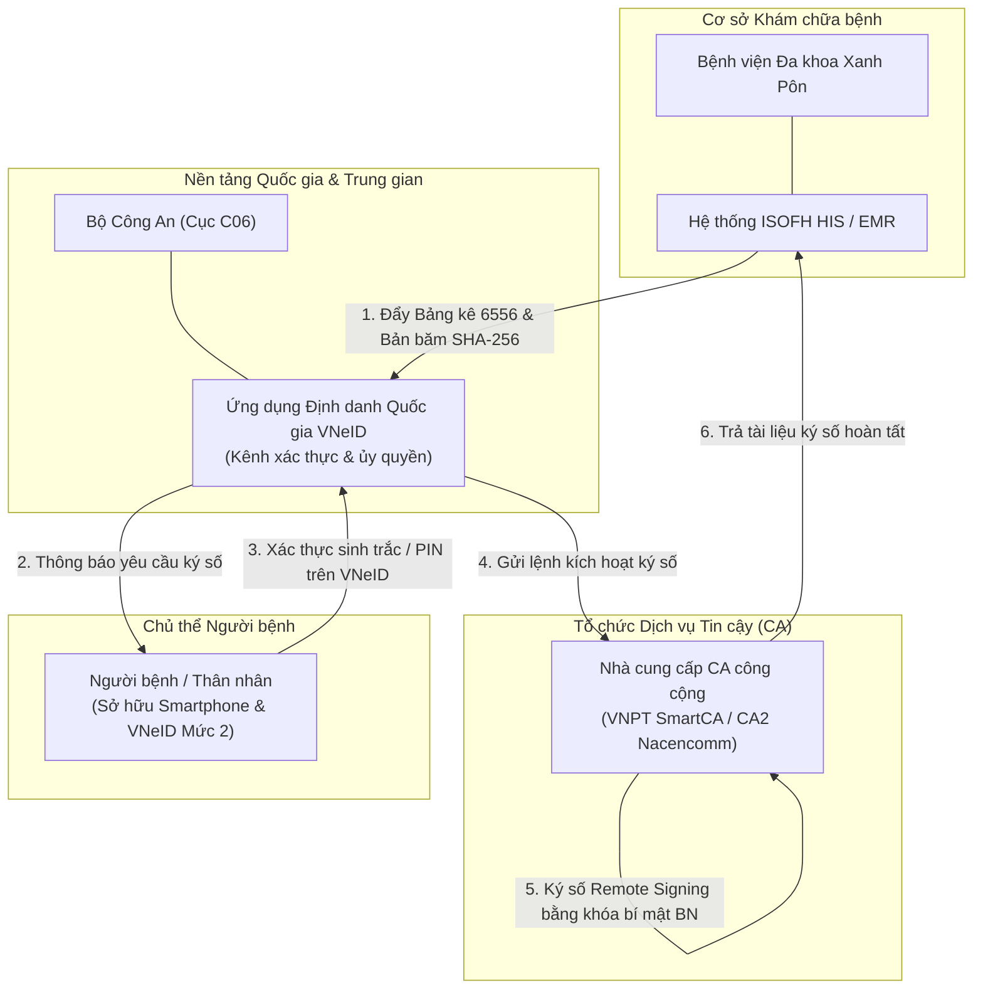

# ISOFH — Mô hình Ký số Bệnh nhân qua Ứng dụng VNeID tại Bệnh viện Đa khoa Xanh Pôn

---

## 1. Thông tin Doanh nghiệp & Vị thế trong Hệ sinh thái Y tế

- **Tên pháp nhân:** Công ty Cổ phần Công nghệ ISOFH `[Đã xác minh từ CSDL Doanh nghiệp]`.
  - *Mã số thuế:* 0106821360.
  - *Sản phẩm chủ lực:* Hệ thống Quản lý Bệnh viện thông minh (HIS), Hệ thống Bệnh án điện tử (ISOFH EMR), Nền tảng y tế số liên thông.
- **Vai trò trong chuỗi cung ứng Y tế:** ISOFH là một trong những đơn vị phát triển phần mềm HIS/EMR độc lập hàng đầu tại khu vực phía Bắc, tiên phong tham gia các chương trình chuyển đổi số y tế trọng điểm theo Đề án 06 của Chính phủ.
- **Đối tác triển khai tiêu biểu:** Bệnh viện Đa khoa Xanh Pôn Hà Nội (Bệnh viện hạng I tuyến đầu của Thủ đô), Trung tâm Dữ liệu quốc gia về dân cư (C06 - Bộ Công An) và các nhà cung cấp dịch vụ chứng thực chữ ký số công cộng tích hợp trên VNeID (VNPT SmartCA, CA2 - Nacencomm).

---

## 2. Sản phẩm & Cơ chế Công nghệ trong Bệnh viện

### 2.1 Mối quan hệ giữa 4 Chủ thể trong Chuỗi Giải pháp
Để hiểu đúng bản chất công nghệ, cần phân định rạch ròi vai trò của 4 chủ thể tham gia:

1. **Bệnh viện Đa khoa Xanh Pôn:** Cơ sở y tế chủ quản phát sinh hồ sơ bệnh án và biểu mẫu bảng kê chi phí điều trị (Bảng kê 6556 theo quy định của Bộ Y tế và Bảo hiểm Xã hội).
2. **Công ty ISOFH:** Nhà phát triển phần mềm HIS/EMR, thực hiện kết nối API giữa hệ thống quản lý bệnh viện với nền tảng VNeID.
3. **Ứng dụng VNeID (Bộ Công An - C06):** Đóng vai trò là **Nền tảng Định danh & Xác thực Điện tử Quốc gia (Identity & Authentication Provider)**. *Lưu ý chuyên môn quan trọng:* VNeID **không phải là một CA công cộng**; VNeID đóng vai trò kênh giao tiếp an toàn, định danh công dân ở Mức độ 2 và truyền nhận thông điệp ủy quyền ký.
4. **Nhà cung cấp Dịch vụ Tin cậy (CA công cộng):** Các tổ chức CA được cấp phép (như VNPT SmartCA, CA2) cung cấp chứng thư số cá nhân và hệ thống ký số từ xa (Remote Signing) kết nối sẵn vào ứng dụng VNeID để người dân sử dụng.

### 2.2 Phân biệt Hai Luồng Kỹ thuật Thực tế
1. **Luồng Ký số PKI Cá nhân qua VNeID (Nhóm 1 Thông tư 13/2025/TT-BYT):**
   - Người bệnh đã kích hoạt chứng thư số cá nhân của CA đối tác (như VNPT SmartCA) tích hợp sẵn trong tài khoản VNeID.
   - Khi bệnh viện đẩy Bảng kê 6556 sang, VNeID gửi thông báo (Push Notification).
   - Người bệnh mở ứng dụng VNeID, xem trước toàn văn bảng kê, nhập mã PIN hoặc quét sinh trắc học khuôn mặt/vân tay trên điện thoại để ủy quyền kích hoạt khóa bí mật cá nhân tại CA.
   - CA thực hiện ký số Remote Signing lên bản băm SHA-256 của tài liệu và trả về chữ ký số PKI cá nhân chuẩn PAdES.
2. **Luồng Xác nhận Điện tử trên VNeID (Nhóm 3 Thông tư 13/2025/TT-BYT):**
   - Trong trường hợp người bệnh chưa đăng ký chứng thư số cá nhân với CA, người bệnh sử dụng tài khoản định danh VNeID Mức 2 để đăng nhập và bấm nút "Xác nhận chấp thuận" nội dung bảng kê.
   - Thao tác này là một hình thức **xác nhận bằng phương tiện điện tử khác** theo quy định tại khoản 4 Điều 22 Luật GDĐT 2023.

---

## 3. Căn cứ Pháp lý & Đánh giá Tuân thủ

- **Phân nhóm theo Thông tư số 13/2025/TT-BYT (Điều 3):**
  - Nếu người bệnh ký số bằng chứng thư số cá nhân tích hợp trên VNeID: Thuộc **Nhóm 1 (Sử dụng chữ ký điện tử hợp pháp)**.
  - Nếu người bệnh chỉ đăng nhập VNeID và bấm nút xác nhận: Thuộc **Nhóm 3 (Sử dụng các hình thức xác nhận bằng phương tiện điện tử khác)**.
- **Căn cứ Luật Giao dịch điện tử số 20/2023/QH15:**
  - *Điều 11 & Điều 23:* Việc xác thực qua tài khoản định danh điện tử VNeID Mức 2 do Bộ Công An cấp mang lại độ tin cậy rất cao trong việc xác định chính xác danh tính người thực hiện thao tác. Khi kết hợp với chữ ký số từ xa của CA đối tác, văn bản có giá trị pháp lý tương đương chữ ký tay của cá nhân theo khoản 2 Điều 23.
  - *Lưu ý pháp lý chuyên sâu:* Việc tài khoản VNeID được xác thực danh tính **không đồng nghĩa với việc loại bỏ mọi tranh chấp về ý chí**. Nếu bệnh nhân khiếu nại rằng họ bị người khác cầm điện thoại bấm hộ hoặc bị nhầm lẫn nội dung bảng kê, cơ quan tài phán vẫn xem xét toàn diện nhật ký phiên làm việc và bằng chứng thực tế tại cơ sở y tế.
- **Tuân thủ Luật Bảo vệ dữ liệu cá nhân số 91/2025/QH15 & Nghị định số 356/2025/NĐ-CP:**
  - Dữ liệu khám chữa bệnh và chi phí điều trị là dữ liệu cá nhân nhạy cảm (Điều 26 Luật 91/2025/QH15).
  - Luồng truyền nhận dữ liệu giữa ISOFH EMR và VNeID phải được mã hóa đầu cuối và tuân thủ các quy định bảo mật của Bộ Công An và Bộ Y tế.

---

## 4. Khách hàng & Triển khai Thực tế: Kiểm chứng Mốc Thời gian & Phạm vi

- **Kiểm chứng chính xác mốc thời gian tại Bệnh viện Đa khoa Xanh Pôn:**
  - *Thời điểm bắt đầu triển khai:* **Ngày 22/05/2025** `[Đã xác minh từ thông cáo chính thức của ISOFH và Bệnh viện Xanh Pôn]`.
  - *Thời điểm công bố báo chí rộng rãi:* **Ngày 12/06/2025** trên các phương tiện truyền thông chính thống (Báo Công an nhân dân, Báo Sức khỏe & Đời sống, Báo VnExpress, Truyền hình Hà Nội) `[Đã xác minh từ nguồn báo chí chính thống]`.
  - *(Hiệu chỉnh quan trọng: Loại bỏ hoàn toàn mốc thời gian tháng 11/2023–2024 không chính xác ở các dự thảo trước)*.
- **Phạm vi triển khai được công bố:**
  - Áp dụng cho **100% người bệnh điều trị nội trú** và thí điểm tại **03 phòng khám ngoại trú** thuộc Khoa Khám bệnh của Bệnh viện Xanh Pôn `[Do doanh nghiệp và bệnh viện công bố]`.
  - Biểu mẫu áp dụng: Bảng kê chi phí điều trị nội trú và ngoại trú (Bảng kê 6556).
- **Đánh giá mức độ vận hành lâm sàng thực tế:**
  - Con số "100% người bệnh nội trú" là **chỉ tiêu và phạm vi chính sách do Bệnh viện Xanh Pôn công bố**.
  - *Thực tế vận hành lâm sàng:* Không thể mặc định rằng 100% người bệnh trên thực tế đều tự thao tác thành công bằng điện thoại thông minh cá nhân. Trong thực tế, nhóm bệnh nhân cao tuổi, bệnh nhân không sở hữu smartphone hoặc chưa kích hoạt VNeID Mức 2 vẫn cần sự hỗ trợ của điều dưỡng hoặc áp dụng phương án ký dự phòng trên giấy/tablet `[Nhận định chuyên môn dựa trên khảo sát quy trình bệnh viện]`.

---

## 5. Bảng Đánh giá Tiêu chuẩn 13 Tiêu chí & Khả năng Cạnh tranh vs EasyCA

| STT | Tiêu chí Đánh giá | Hồ sơ Giải pháp ISOFH / VNeID (Xanh Pôn) | Hồ sơ Đề xuất EasyCA (SoftDreams) |
|:---:|---|---|---|
| 1 | **Vai trò trong hệ sinh thái** | Nhà phát triển HIS/EMR kết nối nền tảng định danh VNeID | Tổ chức cung cấp dịch vụ chứng thực chữ ký số công cộng (CA công cộng) |
| 2 | **Sản phẩm & giải pháp** | ISOFH EMR kết nối VNeID & CA đối tác (VNPT/CA2) | EasyCA Remote Signing, Cổng ký số bệnh nhân Open API |
| 3 | **Phương thức ký người bệnh** | Ký số PKI qua app VNeID hoặc Xác nhận điện tử trên VNeID | Chữ ký số PKI cá nhân (Remote Signing / HSM) kết hợp eKYC |
| 4 | **Đối tượng ký chính** | Người bệnh nội trú & ngoại trú có tài khoản VNeID Mức 2 | Thiết kế phục vụ mọi nhóm người bệnh (trực tiếp & từ xa) |
| 5 | **Khả năng tích hợp HIS/EMR** | Tích hợp sẵn trong phần mềm ISOFH EMR; đóng gói khép kín | Độc lập, sẵn sàng mở cổng Open API tích hợp với mọi HIS/EMR |
| 6 | **Khả năng Remote Signing** | Dựa vào hạ tầng CA đối tác tích hợp trên VNeID | `[Đã xác minh]` Tự chủ hạ tầng theo Giấy phép 82/GP-BTTTT |
| 7 | **Khả năng sử dụng HSM** | Dùng HSM của CA đối tác để quản lý khóa người bệnh | `[Đã xác minh]` Sở hữu hạ tầng HSM chuyên dụng đạt chuẩn quốc tế |
| 8 | **Khả năng xác thực sinh trắc** | Cực mạnh: Dữ liệu định danh Mức 2 do Bộ Công An quản lý | Thiết kế hỗ trợ eKYC (đối soát khuôn mặt & chip CCCD) |
| 9 | **Bằng chứng triển khai tại BV** | `[Đã xác minh]` Đã vận hành tại Bệnh viện Xanh Pôn từ 22/05/2025 | `[Chưa xác minh]` Chưa có dự án bệnh viện vận hành chính thức |
| 10 | **Lợi thế cạnh tranh nổi bật** | Thương hiệu Đề án 06 và uy tín quốc gia của ứng dụng VNeID | Tính trung lập, không phụ thuộc vào hạ tầng VNeID khi có sự cố mạng |
| 11 | **Hạn chế cốt lõi** | Bắt buộc bệnh nhân phải có smartphone, internet & VNeID Mức 2 | Chưa có dự án thực tế tại bệnh viện để làm hồ sơ năng lực |
| 12 | **Mức độ đe dọa với EasyCA** | **Rất cao (Benchmark Model):** Là mô hình chuẩn được Bộ Y tế khuyến khích | **Cơ hội hợp tác:** EasyCA trở thành CA đối tác tích hợp vào VNeID/ISOFH |
| 13 | **Những điểm chưa xác minh** | Chi phí kết nối kỹ thuật thực tế vào nền tảng VNeID | Thời gian trung bình hoàn tất eKYC của EasyCA so với mở VNeID |

### Phân tích Chiến lược Cạnh tranh của EasyCA:
1. **Mô hình Dự phòng Đa kênh (Multi-channel Strategy):** Mô hình VNeID của Xanh Pôn là mô hình tiên phong đáng học hỏi, nhưng có điểm nghẽn lớn: phụ thuộc hoàn toàn vào việc người bệnh phải có smartphone cài sẵn VNeID Mức 2 và điện thoại có kết nối 4G/Wifi. Khi người bệnh là người già, trẻ em, hoặc điện thoại hết pin/không có mạng, luồng ký VNeID bị tê liệt. EasyCA có thể định vị giải pháp đa kênh linh hoạt: hỗ trợ ký qua VNeID khi thuận tiện, đồng thời hỗ trợ luồng eKYC tại quầy tiếp đón hoặc ký xác nhận qua thiết bị chuyên dụng của bệnh viện.
2. **Cơ hội Trở thành CA cung cấp dịch vụ trên VNeID:** Thay vì đối đầu trực diện với mô hình VNeID, SoftDreams có thể xúc tiến kết nối kỹ thuật để EasyCA trở thành một trong các nhà cung cấp chữ ký số công cộng được tích hợp chính thức trên nền tảng VNeID (tương tự như VNPT SmartCA hay CA2), mở ra cơ hội cung cấp dịch vụ cho mọi bệnh viện triển khai mô hình này.

---

## 6. Nguồn Tham khảo & Bằng chứng Xác thực
1. Cổng thông tin Công ty Cổ phần Công nghệ ISOFH: Thông cáo triển khai ký số người bệnh trên VNeID tại Bệnh viện Xanh Pôn ngày 12/06/2025 (`isofh.com`).
2. Báo Điện tử Công an nhân dân (`cand.com.vn`) — "Bệnh viện Xanh Pôn tiên phong ký số trên ứng dụng VNeID", ngày 12/06/2025.
3. Báo Sức khỏe & Đời sống — Cơ quan ngôn luận của Bộ Y tế (`suckhoedoisong.vn`) — "Hà Nội: Người bệnh ký số bệnh án trên VNeID tại Bệnh viện Xanh Pôn", tháng 06/2025.
4. Báo VnExpress (`vnexpress.net`) — "Bệnh nhân viện Xanh Pôn ký số trên VNeID", ngày 13/06/2025.
5. Quyết định số 06/QĐ-TTg của Thủ tướng Chính phủ phê duyệt Đề án 06.
6. Luật Giao dịch điện tử số 20/2023/QH15 và Thông tư số 13/2025/TT-BYT của Bộ Y tế.
