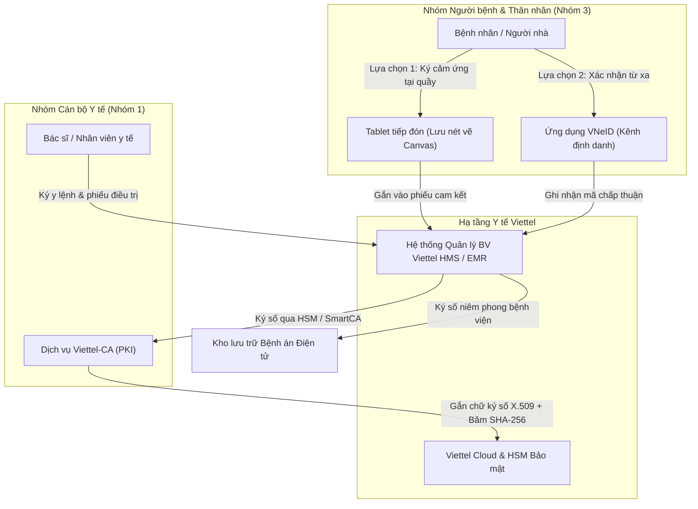

# Viettel Solutions — Hệ sinh thái Viettel HMS & Dịch vụ Chữ ký số Viettel-CA

---

## 1. Thông tin Doanh nghiệp & Vị thế trong Hệ sinh thái Y tế

- **Tên pháp nhân:** Tổng công ty Giải pháp Doanh nghiệp Viettel (Viettel Solutions) — Chi nhánh Tập đoàn Công nghiệp - Viễn thông Quân đội `[Đã xác minh từ CSDL Doanh nghiệp]`.
- **Sản phẩm & Giải pháp cốt lõi:**
  - Hệ thống Quản lý Thông tin Bệnh viện (Viettel HMS), Hồ sơ Bệnh án Điện tử (Viettel EMR), Phần mềm Quản lý Trạm Y tế xã/phường (V-HMIS), Hệ thống Lưu trữ & Truyền tải Hình ảnh y tế (Viettel PACS) `[Đã xác minh]`.
  - Dịch vụ chứng thực chữ ký số công cộng Viettel-CA, Dịch vụ Chữ ký số từ xa Viettel SmartCA, Hạ tầng bảo mật HSM tập trung và Điện toán đám mây Viettel Cloud `[Đã xác minh từ giấy phép Bộ TT&TT]`.
- **Phân tách ba vai trò trong chuỗi cung ứng Y tế:**
  1. *Nhà phát triển phần mềm y tế (HIS/EMR Vendor):* Tự chủ phát triển và triển khai hệ thống phần mềm quản lý bệnh viện tại nhiều tỉnh thành.
  2. *Tổ chức cung cấp dịch vụ chứng thực chữ ký số (CA công cộng):* Một trong những đơn vị CA có thị phần doanh nghiệp và hạ tầng kỹ thuật lớn nhất Việt Nam.
  3. *Nhà tích hợp hệ thống tổng thể (System Integrator):* Cung cấp trọn gói từ đường truyền cáp quang, hạ tầng Trung tâm dữ liệu (Tier 3), thiết bị mạng, bảo mật thông tin đến ứng dụng phần mềm y tế.
- **Mức độ hiện diện thị trường:** Viettel có sự hiện diện rất lớn tại khối bệnh viện công lập (bệnh viện đa khoa tuyến tỉnh, bệnh viện chuyên khoa và trung tâm y tế quân - dân y) thông qua các gói thầu chuyển đổi số y tế quy mô lớn `[Đã xác minh từ Hệ thống Mạng đấu thầu Quốc gia]`.

---

## 2. Sản phẩm & Cơ chế Công nghệ trong Bệnh viện

Trong hệ thống Viettel HMS, quy trình ký duyệt và xác nhận hồ sơ bệnh án được phân tách rạch ròi theo hai nhóm chủ thể:

### 2.1 Chữ ký số cho Nhân viên Y tế (Viettel-CA)
- Bác sĩ, kỹ thuật viên xét nghiệm và điều dưỡng sử dụng chữ ký số Viettel-CA (USB Token hoặc Viettel SmartCA tích hợp HSM) để ký duyệt y lệnh, kết quả cận lâm sàng và bệnh án điện tử.
- Thuộc **Nhóm 1: Sử dụng chữ ký điện tử hợp pháp** theo Điều 3 Thông tư 13/2025/TT-BYT `[Đã xác minh]`.
- Đáp ứng đầy đủ các tiêu chuẩn kỹ thuật về chữ ký số theo quy định của Bộ Thông tin và Truyền thông.

### 2.2 Ký xác nhận của Bệnh nhân & Người nhà bệnh nhân
Đối với đối tượng người bệnh, các cơ sở y tế triển khai Viettel HMS hiện áp dụng các phương thức:
1. **Ký cảm ứng trên Máy tính bảng (Tablet):** Người bệnh vẽ chữ ký tay trên màn hình máy tính bảng tại quầy tiếp đón hoặc giường bệnh. Tùy cấu hình triển khai của từng bệnh viện, hệ thống lưu ảnh chữ ký tĩnh (PNG) hoặc thu thập thêm dấu thời gian và ID tài khoản nhân viên y tế giám sát phiên ký.
2. **Khả năng tích hợp xác nhận qua VNeID:** Viettel đã phát triển năng lực kết nối với cơ sở dữ liệu quốc gia về dân cư theo Đề án 06 để hỗ trợ xác thực danh tính người bệnh khi làm thủ tục khám chữa bệnh `[Đã xác minh qua hồ sơ năng lực Viettel Solutions]`.
3. **Thực tế về Chữ ký số PKI cho Bệnh nhân:** Chưa có tài liệu chính thức xác nhận Viettel đã triển khai cấp chứng thư số PKI cá nhân tức thì cho toàn bộ người bệnh tại các bệnh viện vận hành Viettel HMS `[Nhận định chuyên môn dựa trên khảo sát thực tế lâm sàng]`.

---

## 3. Căn cứ Pháp lý & Đánh giá Tuân thủ Chuyên sâu

- **Phân nhóm theo Thông tư 13/2025/TT-BYT (Điều 3):**
  - Chữ ký số của nhân viên y tế qua Viettel-CA: Thuộc **Nhóm 1 (Chữ ký điện tử hợp pháp)**.
  - Ký cảm ứng Tablet hoặc xác nhận qua VNeID của người bệnh: Thuộc **Nhóm 3 (Sử dụng các hình thức xác nhận bằng phương tiện điện tử khác)** theo khoản 4 Điều 22 Luật GDĐT 2023.
- **Căn cứ Luật Giao dịch điện tử số 20/2023/QH15:**
  - *Điều 11 (Giá trị chứng cứ của thông điệp dữ liệu):* Giá trị chứng cứ của hồ sơ bệnh án được cơ quan tài phán đánh giá dựa trên độ tin cậy của chuỗi nhật ký điện tử (Audit Trail), khả năng xác định danh tính người thao tác và tính toàn vẹn của hồ sơ sau khi ký niêm phong bằng chứng thư số bệnh viện.
  - *Điều 22 & Khoản 2 Điều 23:* Chữ ký số Viettel-CA của bác sĩ có giá trị pháp lý tương đương chữ ký tay; trong khi đó, chữ ký Tablet của bệnh nhân là phương thức thể hiện sự chấp thuận có giá trị ràng buộc dân sự theo thỏa thuận giao dịch.
- **Căn cứ Pháp luật về An toàn Thông tin Mạng (Nghị định số 85/2016/NĐ-CP):**
  - *Hiệu chỉnh quan trọng về pháp lý:* Việc xác định cấp độ an toàn hệ thống thông tin của Viettel HMS căn cứ theo **Luật An toàn thông tin mạng 2015 và Nghị định số 85/2016/NĐ-CP**. Hệ thống thông tin bệnh viện tuyến tỉnh, bệnh viện hạng I thường được thẩm định và phê duyệt phương án bảo đảm an toàn hệ thống thông tin **Cấp độ 3** do quy mô dữ liệu và tầm quan trọng đối với cộng đồng.
  - *(Lưu ý: Không được nhầm lẫn hoặc suy rộng rằng cấp độ an toàn thông tin cấp 3 bắt nguồn từ Luật Bảo vệ dữ liệu cá nhân)*.
- **Tuân thủ Luật Bảo vệ dữ liệu cá nhân số 91/2025/QH15 & Nghị định số 356/2025/NĐ-CP:**
  - Hồ sơ bệnh án điện tử lưu trữ trên Viettel Cloud là **dữ liệu cá nhân nhạy cảm liên quan đến sức khỏe** (Điều 26 Luật 91/2025/QH15).
  - Bệnh viện (Bên kiểm soát) và Viettel (Bên xử lý) phải lập hồ sơ Đánh giá tác động xử lý dữ liệu cá nhân (DPIA) và áp dụng các biện pháp kỹ thuật nghiêm ngặt chống rò rỉ dữ liệu.

---

## 4. Khách hàng & Triển khai Thực tế: Mức độ Hiện diện trên Thị trường

- **Mức độ hiện diện thị trường:**
  - Viettel Solutions là một trong những nhà thầu CNTT y tế lớn nhất Việt Nam tại phân khúc y tế công lập, có tên trong hàng loạt quyết định phê duyệt kết quả lựa chọn nhà thầu cung cấp phần mềm HIS, EMR và chữ ký số `[Đã xác minh qua Hệ thống Mạng đấu thầu Quốc gia]`.
  - Khách hàng tiêu biểu: Nhiều bệnh viện đa khoa tỉnh, bệnh viện ngành và trung tâm y tế tại các tỉnh miền Trung, Tây Nguyên và Đồng bằng sông Cửu Long.
- **Thực tế triển khai chữ ký bệnh nhân:** Đa số các bệnh viện vận hành Viettel HMS hiện vẫn áp dụng quy trình ký giấy cam kết truyền thống rồi scan lưu trữ, hoặc ký cảm ứng trên màn hình Tablet tại khu vực tiếp đón ngoại trú; việc cấp chứng thư chữ ký số PKI cá nhân trực tiếp cho từng người bệnh chưa được triển khai diện rộng `[Nhận định dựa trên khảo sát thực tế lâm sàng]`.

---

## 5. Bảng Đánh giá Tiêu chuẩn 13 Tiêu chí & Khả năng Cạnh tranh vs EasyCA

| STT | Tiêu chí Đánh giá | Hồ sơ Viettel (Viettel HMS / Viettel-CA) | Hồ sơ Đề xuất EasyCA (SoftDreams) |
|:---:|---|---|---|
| 1 | **Vai trò trong hệ sinh thái** | Nhà thầu hạ tầng tổng thể, HIS/EMR vendor & CA công cộng | Tổ chức cung cấp dịch vụ chứng thực chữ ký số công cộng (CA công cộng) |
| 2 | **Sản phẩm & giải pháp** | Viettel HMS, Viettel EMR, Viettel-CA, Viettel SmartCA | EasyCA HSM, EasyCA Remote Signing, Cổng ký số bệnh nhân |
| 3 | **Phương thức ký người bệnh** | Ký cảm ứng trên Tablet (phổ biến) & Thử nghiệm VNeID | Chữ ký số PKI cá nhân (Remote Signing / HSM) kết hợp eKYC |
| 4 | **Đối tượng ký chính** | Cán bộ y tế (Viettel-CA) & Người bệnh (Tablet/VNeID) | Tập trung mở rộng giải pháp ký số cho Người bệnh & Thân nhân |
| 5 | **Khả năng tích hợp HIS/EMR** | Tích hợp sẵn trong Viettel HMS; hạn chế mở cho HIS đối thủ | Độc lập, sẵn sàng mở cổng Open API tích hợp với mọi HIS/EMR |
| 6 | **Khả năng Remote Signing** | `[Đã xác minh]` Có nền tảng Viettel SmartCA | `[Đã xác minh]` Có giấy phép số 82/GP-BTTTT về Remote Signing |
| 7 | **Khả năng sử dụng HSM** | `[Đã xác minh]` Sở hữu hạ tầng HSM quản lý khóa tập trung | `[Đã xác minh]` Sở hữu hạ tầng HSM quản lý khóa tập trung |
| 8 | **Khả năng xác thực sinh trắc** | Hỗ trợ qua thiết bị di động / Nền tảng VNeID | Thiết kế hỗ trợ eKYC (đối soát CCCD gắn chip & khuôn mặt) |
| 9 | **Bằng chứng triển khai tại BV** | `[Đã xác minh]` Triển khai tại nhiều bệnh viện công lập | `[Chưa xác minh]` Chưa có dự án bệnh viện vận hành chính thức |
| 10 | **Lợi thế cạnh tranh nổi bật** | Hạ tầng viễn thông toàn diện, mạng lưới hỗ trợ tại 63 tỉnh/thành | Tính trung lập cao, tập trung giải quyết bài toán nghiệp vụ người bệnh |
| 11 | **Đặc điểm vận hành** | Quy trình quản trị tập trung, tuân thủ lộ trình phiên bản chung | Linh hoạt tùy biến nghiệp vụ, sẵn sàng triển khai thử nghiệm nhanh |
| 12 | **Mức độ đe dọa với EasyCA** | **Cao tại các bệnh viện dùng Viettel HMS:** Khó chen chân vào | **Cơ hội lớn tại các bệnh viện dùng HIS độc lập:** Hợp tác tích hợp |
| 13 | **Những điểm chưa xác minh** | Tỷ lệ bệnh viện sử dụng module ký Tablet so với ký giấy truyền thống | Khả năng chấp nhận chi phí lượt ký PKI của các bệnh viện |

### Chiến lược Định vị Cạnh tranh của EasyCA:
1. **Tránh đối đầu trực diện tại các bệnh viện khép kín của Viettel:** Tại những cơ sở y tế mà Viettel đã trúng thầu trọn gói cả đường truyền, máy chủ Cloud, phần mềm Viettel HMS và chữ ký số Viettel-CA, cơ hội cho EasyCA là rất thấp do tính khép kín của hệ sinh thái.
2. **Tập trung vào phân khúc Bệnh viện sử dụng HIS bên thứ ba:** Hàng trăm bệnh viện công lập và tư nhân đang sử dụng phần mềm HIS độc lập (như ISOFH, Nanosoft, LinkCare, Infomed...) không muốn phụ thuộc vào Viettel vì Viettel HMS là đối thủ cạnh tranh thị phần của các công ty này. EasyCA là đối tác tin cậy và không xung đột lợi ích đối với các đơn vị HIS độc lập.

---

## 6. Nguồn Tham khảo & Bằng chứng Xác thực
1. Hệ thống Mạng đấu thầu Quốc gia (`muasamcong.mpi.gov.vn`) — Các quyết định phê duyệt kết quả lựa chọn nhà thầu liên quan đến Viettel Solutions trong ngành y tế.
2. Cổng thông tin Tổng công ty Giải pháp Doanh nghiệp Viettel: `viettelsolutions.com.vn`.
3. Trang thông tin Dịch vụ Chữ ký số Viettel-CA: `viettel-ca.vn`.
4. Luật Giao dịch điện tử số 20/2023/QH15 và Thông tư số 13/2025/TT-BYT của Bộ Y tế.
5. Luật An toàn thông tin mạng số 86/2015/QH13 và Nghị định số 85/2016/NĐ-CP về bảo đảm an toàn hệ thống thông tin theo cấp độ.
6. Luật Bảo vệ dữ liệu cá nhân số 91/2025/QH15 và Nghị định số 356/2025/NĐ-CP.
