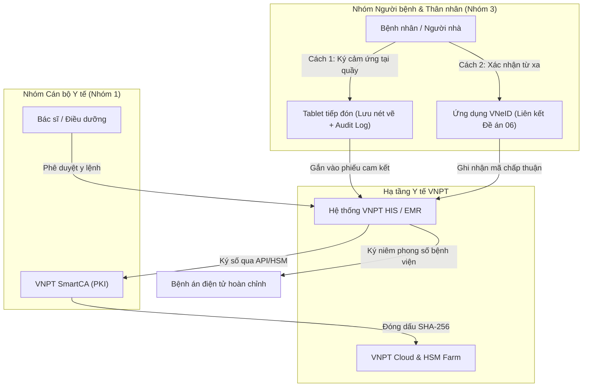

# VNPT-IT — Hệ sinh thái Y tế VNPT HIS & Dịch vụ VNPT SmartCA

---

## 1. Thông tin Doanh nghiệp & Vị thế trong Hệ sinh thái Y tế

- **Tên pháp nhân:** Công ty Công nghệ thông tin VNPT (VNPT-IT) — Chi nhánh Tập đoàn Bưu chính Viễn thông Việt Nam `[Đã xác minh]`.
- **Sản phẩm & Giải pháp cốt lõi:**
  - Hệ thống Quản lý Thông tin Bệnh viện (VNPT HIS), Hồ sơ Bệnh án Điện tử (VNPT EMR), Quản lý Trạm Y tế Xã/Phường (VNPT HMIS), Hệ thống Quản lý Xét nghiệm (VNPT LIS), Hệ thống Lưu trữ & Truyền tải Hình ảnh (VNPT RIS/PACS) `[Đã xác minh]`.
  - Dịch vụ chứng thực chữ ký số công cộng VNPT-CA và Dịch vụ Chữ ký số từ xa VNPT SmartCA `[Đã xác minh theo giấy phép của Bộ TT&TT]`.
- **Phân tách ba vai trò trong chuỗi cung ứng Y tế:**
  1. *Nhà cung cấp dịch vụ tin cậy (CA công cộng):* VNPT là một trong những CA đầu tiên tại Việt Nam, sở hữu hạ tầng chứng thực số quy mô lớn và giấy phép cung cấp dịch vụ chữ ký số từ xa (Remote Signing).
  2. *Nhà phát triển giải pháp phần mềm y tế (HIS/EMR Vendor):* Tự chủ nghiên cứu, xây dựng và làm chủ mã nguồn hệ sinh thái phần mềm quản lý y tế toàn diện từ trạm y tế đến bệnh viện chuyên khoa.
  3. *Nhà tích hợp hệ thống (System Integrator):* Cung cấp trọn gói từ đường truyền viễn thông, hạ tầng trung tâm dữ liệu (VNPT Cloud), thiết bị phần cứng, an toàn thông tin đến giải pháp phần mềm ứng dụng.
- **Mức độ hiện diện thị trường:** VNPT chiếm ưu thế vượt trội tại phân khúc y tế cơ sở (hơn 7.000 trạm y tế xã phường sử dụng VNPT HMIS) và có độ phủ rất lớn tại các trung tâm y tế quận/huyện, bệnh viện đa khoa tuyến huyện và tuyến tỉnh `[Đã xác minh qua báo cáo công khai của Bộ Y tế và Cục CNTT]`.

---

## 2. Sản phẩm & Cơ chế Công nghệ trong Bệnh viện

Trong hệ sinh thái y tế của VNPT, quy trình số hóa và ký duyệt hồ sơ bệnh án được phân tách rõ ràng theo hai nhóm đối tượng:

### 2.1 Chữ ký số cho Nhân viên Y tế (VNPT SmartCA)
- Bác sĩ, dược sĩ, điều dưỡng sử dụng ứng dụng di động VNPT SmartCA hoặc tích hợp chữ ký số tập trung HSM để ký y lệnh, kết quả cận lâm sàng và bệnh án điện tử.
- Thuộc **Nhóm 1: Chữ ký điện tử hợp pháp (Chữ ký số PKI)** theo quy định tại Điều 3 Thông tư 13/2025/TT-BYT `[Đã xác minh]`.
- Đáp ứng đầy đủ các tiêu chuẩn kỹ thuật về chữ ký số theo Thông tư 31/2020/TT-BTTTT và quy chuẩn eIDAS/ETSI.

### 2.2 Ký xác nhận của Bệnh nhân & Người nhà bệnh nhân
Đối với đối tượng người bệnh và thân nhân tại các cơ sở triển khai VNPT HIS, hai phương thức chủ đạo hiện nay là:
1. **Ký cảm ứng trên máy tính bảng (Tablet):** Người bệnh vẽ nét chữ ký trên thiết bị cảm ứng tại quầy tiếp đón hoặc giường bệnh. Hệ thống lưu hình ảnh nét vẽ, dấu thời gian và ID nhân viên giám sát giao dịch.
2. **Xác nhận qua tài khoản định danh VNeID:** Triển khai theo đề án liên thông y tế điện tử, gửi yêu cầu xác nhận thanh toán viện phí hoặc phiếu đồng thuận điều trị về ứng dụng VNeID của công dân `[Đã triển khai thí điểm tại một số bệnh viện như BV Đa khoa Nông nghiệp]`.

### 2.3 Phân tích Kỹ thuật & Rào cản mô hình cấp SmartCA cá nhân cho Người bệnh
Về lý thuyết công nghệ, VNPT sở hữu nền tảng SmartCA hoàn toàn có năng lực cấp chứng thư số cá nhân cho người dân. Tuy nhiên, trong môi trường bệnh viện, mô hình này đối mặt với các rào cản thực tế:
- **Ma sát onboarding tại quầy tiếp đón:** Quy trình đăng ký cấp mới một chứng thư số cá nhân tiêu chuẩn đòi hỏi cài đặt ứng dụng VNPT SmartCA, chụp ảnh CCCD 2 mặt, quay video nhận diện sinh trắc học khuôn mặt và kích hoạt mã PIN bảo mật. Quy trình này thường mất từ 3-7 phút, có nguy cơ gây ùn ứ nghiêm trọng tại các khung giờ cao điểm tiếp đón bệnh nhân `[Nhận định chuyên môn]`.
- **Rào cản mô hình thuê bao (Subscription model):** Chứng thư số cá nhân thông thường được thiết kế theo dạng thuê bao năm (thời hạn 1 năm hoặc nhiều năm). Đối với bệnh nhân vãng lai chỉ đi khám chữa bệnh 1-2 lần trong năm, việc duy trì một thuê bao chữ ký số cá nhân là không thực tế nếu không có cơ chế gói lượt ký (Transaction Pack) được bệnh viện bao cấp chi phí `[Nhận định thị trường]`.
- **Thực tế thị trường:** VNPT chưa thương mại hóa gói giải pháp chuyên biệt "Chữ ký số PKI theo sự vụ (Transactional PKI)" tối ưu hóa thời gian thực cho luồng bệnh nhân ngoại trú tại bệnh viện.

---

## 3. Căn cứ Pháp lý & Đánh giá Tuân thủ

- **Phân nhóm theo Thông tư 13/2025/TT-BYT (Điều 3):**
  - Chữ ký bác sĩ qua VNPT SmartCA: Thuộc **Nhóm 1 (Chữ ký điện tử hợp pháp)**.
  - Ký cảm ứng Tablet / Xác nhận qua VNeID của bệnh nhân: Thuộc **Nhóm 3 (Sử dụng các hình thức xác nhận bằng phương tiện điện tử khác)** theo khoản 4 Điều 22 Luật GDĐT 2023.
- **Căn cứ Luật Giao dịch điện tử số 20/2023/QH15:**
  - *Khoản 11, 12 Điều 3:* Phân định ranh giới giữa chữ ký điện tử nói chung và chữ ký số PKI.
  - *Điều 11:* Giá trị chứng cứ của hồ sơ y tế điện tử được cơ quan tài phán đánh giá dựa trên độ tin cậy của cách thức khởi tạo, gửi, nhận, lưu trữ thông điệp dữ liệu, bảo đảm tính toàn vẹn và khả năng xác định danh tính chủ thể.
  - *Điều 22 & Khoản 2 Điều 23:* Chữ ký số SmartCA của nhân viên y tế đáp ứng đầy đủ điều kiện an toàn và có giá trị pháp lý tương đương chữ ký tay của cá nhân.
- **Tuân thủ Nghị định số 23/2025/NĐ-CP:**
  - VNPT tuân thủ các quy định về tổ chức dịch vụ tin cậy, điều kiện cấp phát chứng thư số bằng phương thức điện tử (Điều 14, 15, 34, 35, 36) và bảo đảm quản lý an toàn khóa bí mật (Điều 37).
- **Tuân thủ Luật Bảo vệ dữ liệu cá nhân số 91/2025/QH15 & Nghị định số 356/2025/NĐ-CP:**
  - Dữ liệu khám chữa bệnh trên VNPT HIS là **dữ liệu cá nhân nhạy cảm** (Điều 26 Luật 91/2025/QH15).
  - Dữ liệu sinh trắc học khuôn mặt khi kích hoạt SmartCA là dữ liệu nhạy cảm theo Điều 31; VNPT bắt buộc phải thực hiện đánh giá tác động xử lý dữ liệu cá nhân (DPIA) theo luật định.

---

## 4. Khách hàng & Triển khai Thực tế: Mức độ Hiện diện trên Thị trường

- **Mức độ hiện diện thị trường:**
  - VNPT là một trong những nhà cung cấp giải pháp CNTT y tế lớn nhất cả nước về số lượng cơ sở kết nối `[Đã xác minh qua Cổng dữ liệu Y tế Bộ Y tế]`.
  - Hệ thống VNPT HMIS phục vụ gần 70% số trạm y tế trên toàn quốc `[Đã xác minh qua báo cáo chuyển đổi số ngành y tế]`.
  - Hàng trăm bệnh viện đa khoa tuyến huyện và bệnh viện tỉnh sử dụng VNPT HIS (như BV ĐK Nông nghiệp, nhiều BV tại các tỉnh phía Bắc, miền Trung và Tây Nam Bộ).
- **Thực tế triển khai chữ ký bệnh nhân:** Các bệnh viện sử dụng VNPT HIS hiện chủ yếu triển khai ký Tablet tại quầy ngoại trú hoặc ký giấy cam kết scan lại; việc triển khai cấp chữ ký số PKI cá nhân trực tiếp cho từng bệnh nhân ký hồ sơ bệnh án vẫn đang ở giai đoạn nghiên cứu mô hình `[Nhận định dựa trên khảo sát thực tế lâm sàng]`.

---

## 5. Bảng Đánh giá Tiêu chuẩn 13 Tiêu chí & Khả năng Cạnh tranh vs EasyCA

| STT | Tiêu chí Đánh giá | Hồ sơ VNPT (VNPT HIS / VNPT SmartCA) | Hồ sơ Đề xuất EasyCA (SoftDreams) |
|:---:|---|---|---|
| 1 | **Vai trò trong hệ sinh thái** | Nhà thầu viễn thông tổng thể, HIS/EMR vendor & CA công cộng | Nhà cung cấp dịch vụ tin cậy (CA công cộng) chuyên sâu |
| 2 | **Sản phẩm & giải pháp liên quan** | VNPT HIS, VNPT EMR, VNPT HMIS, VNPT-CA, VNPT SmartCA | Dịch vụ chứng thực chữ ký số EasyCA, EasyCA Remote Signing |
| 3 | **Phương thức ký người bệnh** | Ký cảm ứng trên Tablet & Thử nghiệm xác nhận VNeID | Chữ ký số PKI cá nhân (Remote Signing / On-demand HSM) |
| 4 | **Đối tượng ký chính** | Cán bộ y tế (SmartCA) & Bệnh nhân (Tablet/VNeID) | Tập trung mở rộng giải pháp ký số cho Người bệnh & Thân nhân |
| 5 | **Khả năng tích hợp HIS/EMR** | Tích hợp sẵn trong VNPT HIS; hạn chế mở cho HIS đối thủ | Độc lập, sẵn sàng mở cổng Open API tích hợp với mọi HIS/EMR |
| 6 | **Khả năng Remote Signing** | `[Đã xác minh]` Có giấy phép & nền tảng VNPT SmartCA | `[Đã xác minh]` Có giấy phép số 82/GP-BTTTT về Remote Signing |
| 7 | **Khả năng sử dụng HSM** | `[Đã xác minh]` Sử dụng HSM quản lý khóa tập trung | `[Đã xác minh]` Sử dụng HSM quản lý khóa tập trung |
| 8 | **Khả năng xác thực sinh trắc** | Hỗ trợ eKYC di động / Tích hợp VNeID | Thiết kế hỗ trợ eKYC (đối soát CCCD gắn chip & khuôn mặt) |
| 9 | **Bằng chứng triển khai tại BV** | `[Đã xác minh]` Hiện diện tại hàng nghìn cơ sở y tế | `[Chưa xác minh]` Chưa có dự án bệnh viện vận hành chính thức |
| 10 | **Lợi thế cạnh tranh nổi bật** | Thỏa thuận chuyển đổi số toàn diện với UBND và Sở Y tế | Tính trung lập, tập trung giải quyết bài toán nghiệp vụ người bệnh |
| 11 | **Hạn chế cốt lõi** | Mô hình thuê bao SmartCA năm không phù hợp ký vãng lai | Chưa có hệ sinh thái phần mềm bệnh viện đi kèm |
| 12 | **Mức độ đe dọa với EasyCA** | **Rất cao (Dominant Player):** Tại các bệnh viện dùng VNPT HIS | **Cơ hội lớn:** Tại các bệnh viện dùng HIS của bên thứ ba |
| 13 | **Những điểm chưa xác minh** | Lộ trình thương mại gói ký số theo sự vụ cho người bệnh | Thời gian tích hợp thực tế API EasyCA vào các hệ thống HIS |

### Chiến lược Cạnh tranh của EasyCA:
1. **Phân khúc bệnh viện dùng HIS bên thứ ba (Non-VNPT HIS):** Nhiều công ty phần mềm y tế độc lập (ISOFH, Infomed, Nanosoft, LinkCare) e ngại tích hợp VNPT SmartCA vì VNPT HIS là đối thủ cạnh tranh trực tiếp của họ. EasyCA là giải pháp CA trung lập, đóng vai trò đối tác công nghệ lý tưởng cho các đơn vị này.
2. **Đóng gói giải pháp Ký số Người bệnh chuyên biệt:** Trong khi VNPT tập trung vào mảng chữ ký số doanh nghiệp và bác sĩ, EasyCA tập trung thiết kế sản phẩm "Ký số Bệnh nhân cấp tốc": eKYC nhanh gọn tại quầy tiếp đón, cấp chứng thư số theo sự vụ, chi phí thanh toán theo gói lượt ký linh hoạt cho bệnh viện.

---

## 6. Nguồn Tham khảo & Bằng chứng Xác thực
1. Cổng thông tin điện tử Tập đoàn Bưu chính Viễn thông Việt Nam: `vnpt.com.vn`.
2. Trang thông tin Dịch vụ Chữ ký số từ xa VNPT SmartCA: `smartca.vnpt.vn`.
3. Báo cáo chuyển đổi số ngành Y tế — Bộ Y tế (`moh.gov.vn`).
4. Danh sách các tổ chức cung cấp dịch vụ chứng thực chữ ký số công cộng được cấp phép — Trung tâm Chứng thực điện tử quốc gia (NEAC): `neac.gov.vn`.
5. Luật Giao dịch điện tử số 20/2023/QH15, Thông tư số 13/2025/TT-BYT, Luật Bảo vệ dữ liệu cá nhân số 91/2025/QH15 và Nghị định số 356/2025/NĐ-CP.
