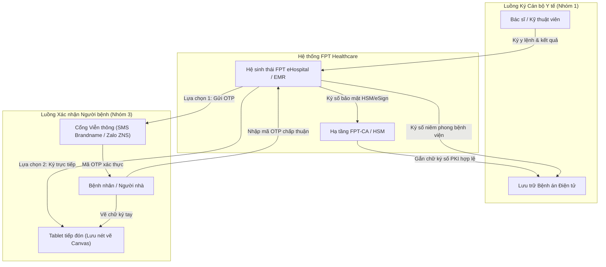

# FPT Healthcare — Hệ sinh thái FPT eHospital & Nền tảng FPT eSign

---

## 1. Thông tin Doanh nghiệp & Vị thế trong Hệ sinh thái Y tế

- **Tên pháp nhân:** Công ty TNHH Hệ thống Thông tin FPT (Tên viết tắt: FPT IS) — Thành viên Tập đoàn FPT `[Đã xác minh từ CSDL Doanh nghiệp]`.
- **Sản phẩm & Giải pháp cốt lõi:**
  - Hệ sinh thái Quản lý Bệnh viện Thông minh FPT eHospital (phiên bản 2.0), Bệnh án Điện tử FPT EMR, Nền tảng Bệnh viện Số FPT Digital Healthcare `[Đã xác minh]`.
  - Nền tảng ký tài liệu số FPT eSign, Dịch vụ chứng thực chữ ký số công cộng FPT-CA (USB Token, HSM, Remote Signing) `[Đã xác minh theo giấy phép Bộ TT&TT]`.
- **Phân tách ba vai trò trong chuỗi cung ứng Y tế:**
  1. *Nhà phát triển giải pháp HIS/EMR (Vendor):* FPT IS là đơn vị tiên phong phát triển phần mềm quản lý bệnh viện tại Việt Nam với hơn 20 năm kinh nghiệm, nổi bật ở phân khúc các bệnh viện quy mô lớn, phức tạp.
  2. *Nhà cung cấp dịch vụ tin cậy (CA công cộng):* FPT-CA là một trong những CA thương mại đầu tiên được cấp phép tại Việt Nam, cung cấp đầy đủ dịch vụ chữ ký số cho doanh nghiệp và cơ quan nhà nước.
  3. *Nhà tích hợp hệ thống tổng thể (System Integrator):* Triển khai đồng bộ phần mềm, hạ tầng máy chủ, hệ thống mạng y tế, kết nối trang thiết bị xét nghiệm và giải pháp an toàn thông tin.
- **Mức độ hiện diện thị trường:** FPT IS có vị thế rất mạnh tại các bệnh viện đa khoa tuyến tỉnh trọng điểm, các chuỗi bệnh viện tư nhân quốc tế lớn và nhiều bệnh viện chuyên khoa `[Đã xác minh qua hồ sơ năng lực và thông cáo báo chí FPT IS]`.

---

## 2. Sản phẩm & Cơ chế Công nghệ trong Bệnh viện

Trong hệ thống FPT eHospital, quy trình ký duyệt và xác nhận hồ sơ bệnh án được phân tách rõ ràng giữa nhân viên y tế và người bệnh:

### 2.1 Bản chất Kỹ thuật của Phương thức Xác nhận qua mã OTP (SMS / Zalo ZNS)
Phương thức sử dụng mã xác thực dùng một lần OTP (One-Time Password) đối với người bệnh được ứng dụng dưới hai vai trò kỹ thuật tách biệt:
1. **Yếu tố xác thực danh tính (Authentication Factor):** Hệ thống kiểm tra người đang thao tác có quyền tiếp cận số điện thoại đã đăng ký trong hồ sơ tiếp đón ban đầu.
2. **Phương thức thể hiện sự chấp thuận (Consent Confirmation):**
   - Khi phát sinh phiếu đồng thuận hoặc bảng kê viện phí, hệ thống phát sinh chuỗi ký tự ngẫu nhiên (mã OTP) có thời hạn hiệu lực ngắn (thường minh họa từ 60 - 180 giây).
   - Mã OTP được truyền tải qua hạ tầng viễn thông (SMS Brandname hoặc Zalo Notification Service - ZNS) đến thiết bị di động của người bệnh.
   - Thao tác người bệnh nhập chính xác mã OTP lên giao diện hệ thống được ghi nhận là hành vi chấp thuận nội dung văn bản điện tử theo khoản 4 Điều 22 Luật GDĐT 2023.

### 2.2 Đánh giá Kỹ thuật & Rào cản Vận hành của Mô hình OTP
- **Phân tích bản chất chứng minh:** Mã OTP chứng minh người thao tác đang nắm giữ số thuê bao viễn thông tại thời điểm nhận mã, **không tự động chứng minh ai là người thực sự cầm máy** (người bệnh hay người nhà bấm hộ) và không tự chứng minh người bệnh đã đọc hiểu toàn bộ nội dung tài liệu `[Nhận định chuyên môn]`.
- **Yêu cầu dữ liệu kiểm toán (Audit Trail) bắt buộc:**
  Để phương thức OTP có giá trị chứng cứ vững chắc trước cơ quan tố tụng, hệ thống FPT eHospital cần lưu trữ đầy đủ chuỗi nhật ký điện tử:
  - Mã định danh giao dịch duy nhất (Transaction ID).
  - ID và phiên bản cụ thể của tài liệu tại thời điểm gửi OTP.
  - Mã băm SHA-256 của tài liệu y tế để chống sửa đổi sau thời điểm xác nhận.
  - Thời gian phát sinh OTP, nhà mạng truyền dẫn, kết quả giao nhận từ nhà mạng (Delivery Receipt).
  - Thời điểm người dùng nhập mã, địa chỉ IP/thiết bị tiếp nhận và tài khoản nhân viên y tế giám sát phiên giao dịch.
- **Rào cản vận hành cần đo kiểm thực địa:**
  - *Chi phí viễn thông:* Bệnh viện phải chịu chi phí phát sinh thường xuyên cho từng tin nhắn SMS Brandname hoặc thông báo ZNS gửi đi `[Thông tin thị trường phổ biến]`.
  - *Vấn đề sóng viễn thông:* Tại một số khu vực đặc thù của bệnh viện (phòng chụp bức xạ X-quang, MRI có lồng Faraday, khu vực tầng hầm, phòng phẫu thuật cách âm tiêu chuẩn), sóng di động có thể bị suy giảm, tiềm ẩn nguy cơ làm chậm trễ việc nhận mã OTP `[Nhận định kỹ thuật / Cần đo kiểm thực địa]`.

---

## 3. Căn cứ Pháp lý & Đánh giá Tuân thủ

- **Phân nhóm theo Thông tư 13/2025/TT-BYT (Điều 3):**
  - Chữ ký số của nhân viên y tế qua FPT-CA: Thuộc **Nhóm 1 (Chữ ký điện tử hợp pháp)** `[Đã xác minh]`.
  - Xác nhận bằng mã OTP (SMS/Zalo) hoặc ký Tablet của người bệnh: Thuộc **Nhóm 3 (Sử dụng các hình thức xác nhận bằng phương tiện điện tử khác)** theo quy định tại khoản 4 Điều 22 Luật GDĐT 2023.
- **Căn cứ Luật Giao dịch điện tử số 20/2023/QH15:**
  - *Điều 11 (Giá trị chứng cứ của thông điệp dữ liệu):* Phương thức OTP không mặc nhiên là chữ ký số PKI, nhưng **hoàn toàn có giá trị chứng cứ** nếu cơ sở khám chữa bệnh lưu trữ đầy đủ chuỗi nhật ký điện tử (Audit Log) chứng minh quy trình gửi nhận tin cậy và tính toàn vẹn của hồ sơ.
  - *Điều 22 khoản 4 & Điều 23:* Pháp luật thừa nhận sự chấp thuận bằng phương tiện điện tử khác khi được các bên thỏa thuận, bảo đảm giá trị pháp lý ràng buộc trong giao dịch khám chữa bệnh.
- **Tuân thủ Luật Bảo vệ dữ liệu cá nhân số 91/2025/QH15 & Nghị định số 356/2025/NĐ-CP:**
  - Số điện thoại, thông tin định danh và hồ sơ y tế gửi qua các kênh truyền dẫn OTT (như Zalo) phải bảo đảm các cam kết bảo vệ dữ liệu cá nhân nhạy cảm theo Điều 26 Luật 91/2025/QH15. Bệnh viện và đơn vị tích hợp phải ký kết thỏa thuận xử lý dữ liệu chặt chẽ.

---

## 4. Khách hàng & Triển khai Thực tế: Đánh giá Tính xác thực của Bằng chứng

- **Mức độ hiện diện thị trường:**
  - FPT eHospital là một trong những giải pháp HIS có uy tín kỹ thuật cao nhất tại Việt Nam, đặc biệt ở các bệnh viện quy mô giường bệnh lớn và yêu cầu nghiệp vụ phức tạp `[Đã xác minh qua hồ sơ năng lực FPT IS]`.
- **Kiểm chứng từng khách hàng tiêu biểu:**
  1. *Bệnh viện Đa khoa tỉnh Quảng Ninh & Bệnh viện Bãi Cháy:* Triển khai hệ thống FPT.eHospital và bệnh án điện tử FPT.EMR phục vụ cán bộ y tế `[Đã xác minh qua Cổng thông tin Quảng Ninh và FPT IS]`.
  2. *Bệnh viện Đa khoa Đồng Nai:* Triển khai hệ thống FPT.eHospital quy mô lớn với 35 phân hệ `[Đã xác minh qua thông cáo FPT IS]`.
  3. *Tập đoàn Y khoa Hoàn Mỹ:* Ký hợp đồng trị giá 100 tỷ đồng (tháng 08/2020) triển khai hệ thống FPT.eHospital 2.0 và FPT.EMR trên toàn chuỗi bệnh viện và phòng khám của tập đoàn `[Đã xác minh qua báo chí kinh tế và FPT IS]`.
- **Lưu ý kiểm chứng quan trọng:**
  - Tất cả các dự án trên là triển khai hệ thống quản lý bệnh viện (HIS/EMR) và bệnh án điện tử cho cán bộ y tế.
  - **Chưa tìm thấy tài liệu chính thức** xác nhận các bệnh viện trên đã nghiệm thu và vận hành đại trà giải pháp bắt buộc toàn bộ bệnh nhân ký số PKI cá nhân hoặc bắt buộc xác nhận qua OTP SMS/Zalo cho mọi hồ sơ bệnh án `[Chưa xác minh được mức độ vận hành ký số người bệnh]`.

---

## 5. Bảng Đánh giá Tiêu chuẩn 13 Tiêu chí & Khả năng Cạnh tranh vs EasyCA

| STT | Tiêu chí Đánh giá | Hồ sơ FPT (FPT eHospital / FPT-CA) | Hồ sơ Đề xuất EasyCA (SoftDreams) |
|:---:|---|---|---|
| 1 | **Vai trò trong hệ sinh thái** | Nhà phát triển HIS/EMR hàng đầu, CA công cộng & Nhà tích hợp SI | Tổ chức cung cấp dịch vụ chứng thực chữ ký số công cộng (CA công cộng) |
| 2 | **Sản phẩm & giải pháp** | FPT eHospital, FPT EMR, FPT eSign, FPT-CA | EasyCA HSM, EasyCA Remote Signing, Cổng ký số bệnh nhân |
| 3 | **Phương thức ký người bệnh** | Xác thực qua OTP (SMS/Zalo ZNS) & Ký vẽ trên Tablet | Chữ ký số PKI cá nhân (Remote Signing / HSM) kết hợp eKYC |
| 4 | **Đối tượng ký chính** | Cán bộ y tế (FPT-CA) & Người bệnh (OTP/Tablet) | Tập trung mở rộng giải pháp ký số cho Người bệnh & Thân nhân |
| 5 | **Khả năng tích hợp HIS/EMR** | Tích hợp sẵn trong FPT eHospital; chi phí kết nối ngoài cao | Độc lập, sẵn sàng mở cổng Open API tích hợp với mọi HIS/EMR |
| 6 | **Khả năng Remote Signing** | `[Đã xác minh]` Có nền tảng FPT eSign & CA | `[Đã xác minh]` Có giấy phép số 82/GP-BTTTT về Remote Signing |
| 7 | **Khả năng sử dụng HSM** | `[Đã xác minh]` Sở hữu hạ tầng HSM quản lý khóa tập trung | `[Đã xác minh]` Sở hữu hạ tầng HSM quản lý khóa tập trung |
| 8 | **Khả năng xác thực sinh trắc** | Xác thực qua OTP viễn thông hoặc đối soát CCCD | Thiết kế hỗ trợ eKYC (đối soát CCCD gắn chip & khuôn mặt) |
| 9 | **Bằng chứng triển khai tại BV** | `[Đã xác minh HIS tại nhiều BV lớn]`; Ký số BN `[Chưa xác minh]` | `[Chưa xác minh]` Chưa có dự án bệnh viện vận hành chính thức |
| 10 | **Lợi thế cạnh tranh nổi bật** | Thương hiệu FPT mạnh, năng lực làm chủ hệ thống phức tạp | Chi phí cạnh tranh, linh hoạt nghiệp vụ, không cạnh tranh HIS |
| 11 | **Hạn chế cốt lõi** | Phương thức OTP phát sinh chi phí viễn thông thường xuyên | Thiếu hệ sinh thái phần mềm bệnh viện tự phát triển |
| 12 | **Mức độ đe dọa với EasyCA** | **Cao tại các bệnh viện dùng FPT eHospital:** Khó thay thế | **Cơ hội hợp tác:** Đề xuất làm cổng ký số chuyên dụng |
| 13 | **Những điểm chưa xác minh** | Tỷ lệ bệnh viện vận hành thực tế module OTP cho người bệnh | Khả năng bệnh viện sẵn sàng đổi từ OTP sang ký số PKI |

### Chiến lược Định vị Cạnh tranh của EasyCA:
1. **Bài toán kinh tế (TCO) so với OTP:** EasyCA định vị giải pháp Ký số PKI theo gói lượt ký (Transaction Pack) có chi phí dự báo được, giúp bệnh viện loại bỏ hoàn toàn rủi ro tăng chi phí tin nhắn viễn thông biến đổi theo lượt khám bệnh.
2. **Nâng chuẩn giá trị chứng minh:** Trong khi OTP chỉ thuộc Nhóm 3 (Xác nhận điện tử), EasyCA đưa chữ ký người bệnh lên **Nhóm 1 (Chữ ký điện tử hợp pháp - PKI)** với đầy đủ chứng thư số cá nhân, hàm băm SHA-256 bảo đảm tính toàn vẹn và giá trị chứng minh tố tụng cao nhất trong trường hợp xảy ra khiếu nại chuyên môn.

---

## 6. Nguồn Tham khảo & Bằng chứng Xác thực
1. Cổng thông tin Công ty TNHH Hệ thống Thông tin FPT: `fpt-is.com`.
2. Trang thông tin Dịch vụ Chứng thực Chữ ký số FPT-CA: `fpt-ca.vn`.
3. Báo Sài Gòn Giải Phóng (`sggp.org.vn`) — "FPT IS và Tập đoàn Y khoa Hoàn Mỹ ký kết hợp đồng chuyển đổi số y tế", tháng 08/2020.
4. Cổng thông tin điện tử tỉnh Quảng Ninh (`quangninh.gov.vn`) — Báo cáo ứng dụng CNTT ngành y tế tỉnh Quảng Ninh.
5. Danh sách các tổ chức cung cấp dịch vụ chứng thực chữ ký số công cộng được cấp phép — Trung tâm Chứng thực điện tử quốc gia (NEAC): `neac.gov.vn`.
6. Luật Giao dịch điện tử số 20/2023/QH15, Thông tư số 13/2025/TT-BYT và Luật Bảo vệ dữ liệu cá nhân số 91/2025/QH15.
