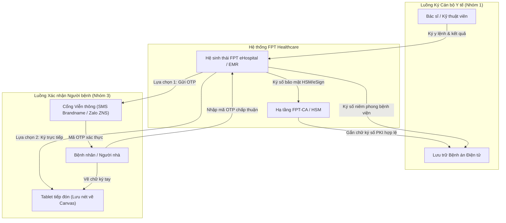

# FPT Healthcare — Hệ sinh thái FPT eHospital & Nền tảng FPT eSign

---

## 1. Thông tin Doanh nghiệp & Vị thế trong Hệ sinh thái Y tế

- **Tên pháp nhân:** Công ty TNHH Hệ thống Thông tin FPT (FPT IS) — Thành viên Tập đoàn FPT `[Đã xác minh]`.
- **Sản phẩm & Giải pháp cốt lõi:**
  - Hệ sinh thái Quản lý Bệnh viện Thông minh FPT eHospital, Bệnh án Điện tử FPT EMR, Hệ thống Bệnh viện Số FPT Digital Healthcare `[Đã xác minh]`.
  - Nền tảng ký tài liệu số FPT eSign, Dịch vụ chứng thực chữ ký số công cộng FPT-CA `[Đã xác minh theo giấy phép Bộ TT&TT]`.
- **Phân tách ba vai trò trong chuỗi cung ứng Y tế:**
  1. *Nhà phát triển giải pháp HIS/EMR (Vendor):* FPT IS là đơn vị tiên phong phát triển phần mềm quản lý bệnh viện tại Việt Nam với hơn 20 năm kinh nghiệm, nổi bật ở phân khúc các bệnh viện quy mô lớn, phức tạp.
  2. *Nhà cung cấp dịch vụ tin cậy (CA công cộng):* FPT-CA là một trong những CA thương mại đầu tiên được cấp phép tại Việt Nam, cung cấp đầy đủ chữ ký số USB Token, HSM và dịch vụ ký số từ xa.
  3. *Nhà tích hợp hệ thống tổng thể (System Integrator):* Triển khai đồng bộ phần mềm, hạ tầng máy chủ, hệ thống mạng y tế, kết nối trang thiết bị xét nghiệm và giải pháp an toàn thông tin.
- **Mức độ hiện diện thị trường:** FPT IS có vị thế rất mạnh tại các bệnh viện đa khoa tuyến tỉnh trọng điểm (Quảng Ninh, Đồng Nai...), các chuỗi bệnh viện tư nhân quốc tế lớn (như Tập đoàn Y khoa Hoàn Mỹ) và nhiều bệnh viện chuyên khoa `[Đã xác minh qua thông cáo báo chí và hồ sơ đấu thầu công khai]`.

---

## 2. Sản phẩm & Cơ chế Công nghệ trong Bệnh viện

Trong hệ thống FPT eHospital, quy trình ký duyệt và xác nhận hồ sơ bệnh án được phân tách rõ ràng giữa nhân viên y tế và người bệnh:

### 2.1 Bản chất Kỹ thuật của Phương thức Xác nhận qua mã OTP (SMS / Zalo ZNS)
Phương thức sử dụng mã xác thực dùng một lần OTP (One-Time Password) đối với người bệnh được ứng dụng dưới hai vai trò kỹ thuật tách biệt:
1. **Yếu tố xác thực danh tính (Authentication Factor):** Hệ thống kiểm tra người đang thao tác có quyền tiếp cận số điện thoại đã đăng ký trong hồ sơ tiếp đón ban đầu.
2. **Phương thức thể hiện sự chấp thuận (Consent Confirmation):**
   - Khi phát sinh phiếu đồng thuận phẫu thuật hoặc bảng kê viện phí, hệ thống phát sinh chuỗi ký tự ngẫu nhiên (mã OTP) có thời hạn hiệu lực ngắn (thường 60 - 180 giây).
   - Mã OTP được truyền tải qua hạ tầng viễn thông (SMS Brandname hoặc Zalo Notification Service - ZNS) đến thiết bị di động của người bệnh.
   - Thao tác người bệnh nhập chính xác mã OTP lên giao diện hệ thống được ghi nhận là hành vi chấp thuận nội dung văn bản điện tử theo khoản 4 Điều 22 Luật GDĐT 2023.

### 2.2 Đánh giá Kỹ thuật & Rào cản Vận hành của Mô hình OTP
- **Ưu điểm vận hành:** Bệnh nhân không cần trang bị điện thoại thông minh cấu hình cao, không cần cài đặt ứng dụng mới hay thực hiện quy trình eKYC phức tạp; mức độ thân thiện và quen thuộc cao.
- **Rào cản chi phí viễn thông:**
  - Bệnh viện phải chịu chi phí phát sinh cho từng tin nhắn SMS Brandname hoặc thông báo ZNS gửi đi. Với các bệnh viện quy mô 2.000 - 4.000 lượt khám/ngày, chi phí viễn thông lũy kế hàng tháng là một khoản mục ngân sách vận hành thường xuyên đáng kể `[Nhận định kinh tế vận hành]`.
- **Rào cản hạ tầng mạng & Độ trễ viễn thông:**
  - Tại một số khu vực đặc thù của bệnh viện (phòng chụp bức xạ X-quang, MRI, khu vực tầng hầm, phòng phẫu thuật cách âm tiêu chuẩn), sóng viễn thông di động thường bị suy giảm hoặc chặn sóng, dẫn đến việc nhận mã OTP bị trễ hoặc thất bại `[Đặc thù kỹ thuật viễn thông bệnh viện]`.

---

## 3. Căn cứ Pháp lý & Đánh giá Tuân thủ

- **Phân nhóm theo Thông tư 13/2025/TT-BYT (Điều 3):**
  - Chữ ký số của nhân viên y tế qua FPT-CA: Thuộc **Nhóm 1 (Chữ ký điện tử hợp pháp)** `[Đã xác minh]`.
  - Xác nhận bằng mã OTP (SMS/Zalo) hoặc ký Tablet của người bệnh: Thuộc **Nhóm 3 (Sử dụng các hình thức xác nhận bằng phương tiện điện tử khác)** theo quy định tại khoản 4 Điều 22 Luật GDĐT 2023.
- **Căn cứ Luật Giao dịch điện tử số 20/2023/QH15:**
  - *Điều 11 (Giá trị chứng cứ của thông điệp dữ liệu):* Phương thức OTP không mặc nhiên là chữ ký số PKI, nhưng **hoàn toàn có giá trị chứng cứ** nếu cơ sở khám chữa bệnh lưu trữ đầy đủ chuỗi nhật ký điện tử (Audit Log): thời gian phát sinh OTP, nhà mạng truyền dẫn, trạng thái giao nhận thành công (Delivery Receipt), địa chỉ IP/thiết bị tiếp nhận mã và liên kết chính xác với nội dung văn bản.
  - *Điều 22 khoản 4 & Điều 23:* Pháp luật thừa nhận sự chấp thuận bằng phương tiện điện tử khác khi được các bên thỏa thuận, bảo đảm giá trị pháp lý ràng buộc trong giao dịch khám chữa bệnh.
- **Tuân thủ Luật Bảo vệ dữ liệu cá nhân số 91/2025/QH15 & Nghị định số 356/2025/NĐ-CP:**
  - Số điện thoại, thông tin định danh và hồ sơ y tế gửi qua các kênh viễn thông OTT (như Zalo) phải bảo đảm các cam kết bảo mật thông tin nhạy cảm theo Điều 26 Luật 91/2025/QH15. Bệnh viện và nhà cung cấp phải có thỏa thuận xử lý dữ liệu cá nhân chặt chẽ.

---

## 4. Khách hàng & Triển khai Thực tế: Mức độ Hiện diện trên Thị trường

- **Mức độ hiện diện thị trường:**
  - FPT eHospital là một trong những giải pháp HIS có uy tín kỹ thuật cao nhất tại Việt Nam, đặc biệt ở các bệnh viện quy mô giường bệnh lớn và yêu cầu nghiệp vụ chuyên sâu `[Đã xác minh qua hồ sơ năng lực FPT IS]`.
  - Khách hàng tiêu biểu: Bệnh viện Đa khoa tỉnh Quảng Ninh, Bệnh viện Đa khoa Đồng Nai, Bệnh viện Sản Nhi Quảng Ninh, Bệnh viện Bãi Cháy, cùng nhiều cơ sở thuộc các tập đoàn y tế tư nhân lớn như Hoàn Mỹ `[Đã xác minh qua truyền thông và tin tức triển khai chính thức]`.
- **Thực tế áp dụng chữ ký người bệnh:** Đa số các cơ sở triển khai FPT eHospital hiện áp dụng hình thức ký cảm ứng trên màn hình Tablet tại khu vực ngoại trú, kết hợp xác thực mã OTP cho các giao dịch viện phí trực tuyến; chưa ghi nhận việc cấp phát đại trà chứng thư số PKI cá nhân tức thì cho toàn bộ người bệnh nội trú `[Nhận định dựa trên khảo sát thực tế]`.

---

## 5. Bảng Đánh giá Tiêu chuẩn 13 Tiêu chí & Khả năng Cạnh tranh vs EasyCA

| STT | Tiêu chí Đánh giá | Hồ sơ FPT (FPT eHospital / FPT-CA) | Hồ sơ Đề xuất EasyCA (SoftDreams) |
|:---:|---|---|---|
| 1 | **Vai trò trong hệ sinh thái** | Nhà phát triển HIS/EMR hàng đầu, CA công cộng & Nhà tích hợp SI | Nhà cung cấp dịch vụ tin cậy (CA công cộng) chuyên sâu |
| 2 | **Sản phẩm & giải pháp liên quan** | FPT eHospital, FPT EMR, FPT eSign, FPT-CA | Dịch vụ chứng thực chữ ký số EasyCA, EasyCA Remote Signing |
| 3 | **Phương thức ký người bệnh** | Xác nhận qua OTP (SMS/Zalo ZNS) & Ký vẽ trên Tablet | Chữ ký số PKI cá nhân (Remote Signing / On-demand HSM) |
| 4 | **Đối tượng ký chính** | Cán bộ y tế (FPT-CA) & Người bệnh (OTP/Tablet) | Tập trung mở rộng giải pháp ký số cho Người bệnh & Thân nhân |
| 5 | **Khả năng tích hợp HIS/EMR** | Tích hợp sẵn trong FPT eHospital; chi phí kết nối ngoài cao | Độc lập, sẵn sàng mở cổng Open API tích hợp với mọi HIS/EMR |
| 6 | **Khả năng Remote Signing** | `[Đã xác minh]` Có nền tảng FPT eSign & CA | `[Đã xác minh]` Có giấy phép số 82/GP-BTTTT về Remote Signing |
| 7 | **Khả năng sử dụng HSM** | `[Đã xác minh]` Sử dụng HSM quản lý khóa tập trung | `[Đã xác minh]` Sử dụng HSM quản lý khóa tập trung |
| 8 | **Khả năng xác thực sinh trắc** | Xác thực qua OTP viễn thông hoặc đối soát CCCD | Thiết kế hỗ trợ eKYC (đối soát CCCD gắn chip & khuôn mặt) |
| 9 | **Bằng chứng triển khai tại BV** | `[Đã xác minh]` Triển khai tại hàng chục bệnh viện lớn | `[Chưa xác minh]` Chưa có dự án bệnh viện vận hành chính thức |
| 10 | **Lợi thế cạnh tranh nổi bật** | Thương hiệu FPT mạnh, năng lực làm chủ hệ thống phức tạp | Chi phí cạnh tranh, linh hoạt nghiệp vụ, không cạnh tranh HIS |
| 11 | **Hạn chế cốt lõi** | Phương thức OTP phát sinh chi phí viễn thông thường xuyên | Thiếu hệ sinh thái phần mềm bệnh viện tự phát triển |
| 12 | **Mức độ đe dọa với EasyCA** | **Cao (Strong Competitor):** Tại các bệnh viện đa khoa lớn | **Cơ hội hợp tác:** Đề xuất làm cổng ký số chuyên dụng |
| 13 | **Những điểm chưa xác minh** | Chi phí viễn thông SMS thực tế bệnh viện chi trả mỗi năm | Khả năng bệnh viện sẵn sàng đổi từ OTP sang ký số PKI |

### Chiến lược Định vị Cạnh tranh của EasyCA:
1. **Bài toán kinh tế (TCO) so với OTP:** EasyCA định vị giải pháp Ký số PKI theo gói lượt ký (Transaction Pack) có chi phí cố định, giúp bệnh viện loại bỏ hoàn toàn rủi ro tăng chi phí tin nhắn viễn thông biến đổi theo lượt khám bệnh.
2. **Nâng chuẩn giá trị chứng minh:** Trong khi OTP chỉ thuộc Nhóm 3 (Xác nhận điện tử), EasyCA đưa chữ ký người bệnh lên **Nhóm 1 (Chữ ký điện tử hợp pháp - PKI)** với đầy đủ chứng thư số, hàm băm SHA-256 bảo đảm tính toàn vẹn và khả năng chứng minh cao nhất trong trường hợp xảy ra khiếu nại chuyên môn.

---

## 6. Nguồn Tham khảo & Bằng chứng Xác thực
1. Cổng thông tin Công ty TNHH Hệ thống Thông tin FPT: `fpt-is.com`.
2. Trang thông tin Dịch vụ Chứng thực Chữ ký số FPT-CA: `fpt-ca.vn`.
3. Cổng thông tin Trung tâm Chứng thực điện tử quốc gia (NEAC) — Giấy phép cung cấp dịch vụ CA công cộng của FPT.
4. Luật Giao dịch điện tử số 20/2023/QH15, Thông tư số 13/2025/TT-BYT.
5. Luật Bảo vệ dữ liệu cá nhân số 91/2025/QH15 và Nghị định số 356/2025/NĐ-CP.
