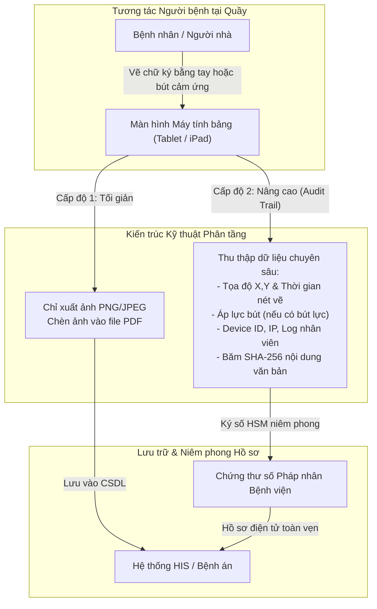

# Mô hình Chữ ký Cảm ứng trên Tablet tại Cơ sở Y tế

---

## 1. Thông tin Giải pháp & Phân khúc Thị trường

- **Đại diện giải pháp tiêu biểu trên thị trường:**
  - Phần mềm Quản lý Nha khoa chuyên dụng: **DentalFlow** (cung cấp tính năng ký xác nhận bệnh án điện tử trực tiếp trên máy tính bảng tại ghế điều trị hoặc quầy lễ tân) `[Đã xác minh từ tài liệu sản phẩm DentalFlow]`, BambuFit.
  - Phân hệ tiếp đón bệnh nhân và ký phiếu khám của các phần mềm quản lý phòng khám/bệnh viện: Nanosoft, LinkCare, phân hệ ký Tablet của VNPT HIS và Viettel HMS `[Đã xác minh qua triển khai thực tế]`.
  - Các module ký phiếu đồng thuận nội bộ do phòng CNTT của các bệnh viện tự phát triển trên nền tảng iPad/Android Tablet `[Có nguồn tham khảo qua khảo sát quy trình bệnh viện]`.
- **Phân khúc thị trường chủ đạo:** Hệ thống phòng khám chuyên khoa tư nhân (nha khoa, thẩm mỹ viện, mắt, da liễu) và các khoa khám bệnh ngoại trú tại các bệnh viện công lập và tư nhân.
- **Vai trò trong hệ sinh thái:** Đóng vai trò là phương tiện thu nhận tương tác chấp thuận trực tiếp của người bệnh tại quầy tiếp đón hoặc tại giường bệnh, thay thế quy trình in ấn giấy tờ thủ công.

---

## 2. Sản phẩm & Cơ chế Công nghệ trong Bệnh viện

Trong thực tế kỹ thuật y tế, một giải pháp ký cảm ứng trên màn hình Tablet không đơn thuần chỉ là một bức ảnh vẽ bitmap; mức độ an toàn và độ tin cậy công nghệ phụ thuộc trực tiếp vào kiến trúc triển khai của nhà phát triển phần mềm:

### 2.1 Phân cấp Kỹ thuật & Yêu cầu Phần cứng Cụ thể
1. **Cấp độ Tối giản (Chỉ thu thập hình ảnh tĩnh):**
   - Người bệnh dùng ngón tay hoặc bút cảm ứng vẽ nét ký trên vùng Canvas màn hình.
   - Phần mềm xuất dữ liệu nét vẽ thành tệp hình ảnh tĩnh (định dạng PNG hoặc JPEG) rồi gắn vào vị trí người bệnh ký trên tài liệu PDF mẫu.
   - *Hạn chế:* Không lưu trữ tọa độ nét vẽ, không có dấu thời gian chuẩn, không gắn chặt chẽ với nội dung văn bản tại thời điểm ký. Nếu xảy ra khiếu nại, rất khó chứng minh ai là người thực sự chạm tay vào màn hình.
2. **Cấp độ Nâng cao (Thu thập chuỗi dữ liệu kiểm toán - Audit Trail & Niêm phong số):**
   - **Tọa độ và thời gian nét vẽ:** Hệ thống thu thập chuỗi dữ liệu động thái ký: chuỗi tọa độ (X, Y) và dấu thời gian của từng điểm ảnh trên nét vẽ.
   - **Dữ liệu áp lực tì đè (Pressure Sensitivity) — Lưu ý phần cứng bắt buộc:**
     - *Phân tích kỹ thuật chính xác:* Dữ liệu áp lực nét vẽ cơ học **chỉ có thể thu thập được khi sử dụng bút cảm ứng lực chuyên dụng** (như Apple Pencil với cảm biến áp lực trên iPad, hoặc bút số hóa điện từ EMR của bảng vẽ Wacom) trên các thiết bị có lớp cảm ứng tương thích.
     - Ngón tay người bệnh hoặc các loại bút cảm ứng điện dung thông thường (Capacitive Stylus đầu cao su/đầu đĩa) **hoàn toàn không có khả năng ghi nhận dữ liệu áp lực tì đè cơ học** `[Đặc tính kỹ thuật phần cứng]`.
   - **Thông tin định danh thiết bị:** Phân biệt rõ các trường thông tin ở các tầng khác nhau:
     - *Device ID:* Mã định danh phần cứng của thiết bị (UDID/Serial Number).
     - *Địa chỉ MAC:* Địa chỉ vật lý của card mạng (thường bị hạn chế truy cập trên các hệ điều hành di động hiện đại như iOS/Android vì lý do bảo mật quyền riêng tư).
     - *Địa chỉ IP nội bộ:* Địa chỉ mạng do router bệnh viện cấp phát cho máy tính bảng tại thời điểm thao tác.
   - **Thông tin nhân viên giám sát:** Ghi nhận mã tài khoản của điều dưỡng/tiếp đón viên trực tiếp mở hồ sơ và giám sát phiên ký.
   - **Niêm phong số:** Ngay sau khi người bệnh bấm xác nhận, hệ thống tính mã băm SHA-256 của toàn bộ nội dung tài liệu và sử dụng **Chứng thư số tổ chức của bệnh viện (HSM)** để ký niêm phong thông điệp dữ liệu.

---

## 3. Căn cứ Pháp lý & Đánh giá Tuân thủ

- **Phân nhóm theo Thông tư 13/2025/TT-BYT (Điều 3):**
  - Chữ ký cảm ứng trên màn hình Tablet thuộc **Nhóm 3: Sử dụng các hình thức xác nhận bằng phương tiện điện tử khác** theo quy định tại khoản 4 Điều 22 Luật Giao dịch điện tử số 20/2023/QH15.
- **Căn cứ Luật Giao dịch điện tử số 20/2023/QH15:**
  - *Điều 8 (Giá trị pháp lý của thông điệp dữ liệu):* Thông tin trong hồ sơ bệnh án không bị phủ nhận giá trị pháp lý chỉ vì được thể hiện dưới dạng điện tử.
  - *Khoản 4 Điều 22 (Hình thức xác nhận khác):* Pháp luật cho phép các bên sử dụng phương tiện điện tử khác để thể hiện sự chấp thuận đối với thông điệp dữ liệu khi pháp luật không bắt buộc phải sử dụng chữ ký số.
  - *Điều 11 (Giá trị chứng cứ của thông điệp dữ liệu):* Chữ ký Tablet không mặc nhiên bị cơ quan tài phán bác bỏ. Giá trị chứng cứ được Hội đồng giám định và Tòa án đánh giá dựa trên độ tin cậy của cách thức khởi tạo, lưu trữ, khả năng bảo đảm tính toàn vẹn của hồ sơ bệnh án và quy trình xác thực người thao tác `[Nhận định pháp lý chuẩn xác]`.
- **Rủi ro Pháp lý & Giám định Tư pháp:**
  - Trong trường hợp người bệnh phủ nhận việc mình đã ký xác nhận (ví dụ trong các sự cố y khoa hoặc tranh chấp chi phí lớn), việc giám định tư pháp nét vẽ điện tử trên màn hình cảm ứng kính phức tạp hơn rất nhiều so với giám định chữ ký bút mực trên giấy truyền thống (vốn có áp lực cơ học in sâu vào thớ giấy).
  - *Phân tích pháp lý quan trọng:* Việc bệnh viện dùng chữ ký số của bệnh viện để niêm phong tài liệu chỉ chứng minh tính toàn vẹn của tài liệu kể từ thời điểm ký niêm phong; **không thể thay thế cho bằng chứng chứng minh chính người bệnh đã chấp thuận nội dung đó**. Mức độ an toàn pháp lý phụ thuộc vào toàn bộ chuỗi nhật ký kiểm toán (Audit Trail) và lời khai của nhân chứng tại cơ sở y tế.

---

## 4. Khách hàng & Triển khai Thực tế: Mức độ Hiện diện trên Thị trường

- **Mức độ hiện diện thị trường:**
  - Ký trên Tablet là phương thức xác nhận điện tử cho người bệnh có **tỷ lệ phổ biến cao nhất hiện nay** tại các cơ sở khám chữa bệnh đã số hóa `[Đã xác minh qua khảo sát thực tế phần mềm y tế]`.
  - Hầu hết các chuỗi nha khoa chuyên nghiệp (như DentalFlow phục vụ hàng trăm phòng khám nha khoa) đều ứng dụng tính năng ký bệnh án trên tablet `[Đã xác minh từ tài liệu DentalFlow]`.
  - Nhiều bệnh viện công lập và tư nhân triển khai module ký Tablet tại quầy tiếp đón bảo hiểm y tế hoặc phòng khám dịch vụ theo yêu cầu.
- **Phân tích Toàn diện Chi phí Sở hữu Toàn bộ (Total Cost of Ownership - TCO):**
  - *Hiệu chỉnh quan trọng:* **Chi phí của mô hình Tablet không phải "gần như bằng 0".**
  - Bệnh viện phải tính toán đầy đủ các khoản mục chi phí:
    1. *Chi phí thiết bị ban đầu:* Mua sắm máy tính bảng (iPad / Android Tablet), bút cảm ứng và giá đỡ chuyên dụng chống trộm tại các quầy tiếp đón.
    2. *Chi phí khấu hao & thay thế phần cứng:* Do tần suất sử dụng liên tục từ hàng nghìn bệnh nhân mỗi ngày, thiết bị dễ bị rơi vỡ màn hình, chai pin hoặc hỏng cảm ứng, đòi hỏi ngân sách thay thế định kỳ `[Nhận định vận hành y tế]`.
    3. *Chi phí bản quyền phần mềm:* Phí bản quyền module ký điện tử trả cho nhà phát triển HIS/phòng khám.
    4. *Chi phí nhân sự vận hành:* Điều dưỡng hoặc nhân viên tiếp đón phải hướng dẫn và giám sát người bệnh thao tác trên thiết bị.

---

## 5. Bảng Đánh giá Tiêu chuẩn 13 Tiêu chí & Khả năng Cạnh tranh vs EasyCA

| STT | Tiêu chí Đánh giá | Mô hình Ký Tablet (DentalFlow / HIS Module) | Hồ sơ Đề xuất EasyCA (SoftDreams) |
|:---:|---|---|---|
| 1 | **Vai trò trong hệ sinh thái** | Giải pháp xác nhận điện tử trực tiếp trên thiết bị đầu cuối | Tổ chức cung cấp dịch vụ chứng thực chữ ký số công cộng (CA công cộng) |
| 2 | **Sản phẩm & giải pháp** | Module Canvas ký tay trên iPad / Android Tablet / Wacom | EasyCA HSM, EasyCA Remote Signing, Cổng ký số bệnh nhân |
| 3 | **Phương thức ký người bệnh** | Vẽ chữ ký bằng ngón tay hoặc bút cảm ứng màn hình | Chữ ký số PKI cá nhân (Remote Signing / HSM) kết hợp eKYC |
| 4 | **Đối tượng ký chính** | Người bệnh & Thân nhân có mặt trực tiếp tại quầy tiếp đón | Thiết kế phục vụ cả Người bệnh trực tiếp và Thân nhân ký từ xa |
| 5 | **Khả năng tích hợp HIS/EMR** | Tích hợp sâu vào giao diện tiếp đón của phần mềm phòng khám | Độc lập, sẵn sàng mở cổng Open API tích hợp với mọi HIS/EMR |
| 6 | **Khả năng Remote Signing** | **Không hỗ trợ:** Bắt buộc phải ký trực tiếp trên thiết bị tại cơ sở | `[Đã xác minh]` Có giấy phép số 82/GP-BTTTT về Remote Signing |
| 7 | **Khả năng sử dụng HSM** | Dùng HSM bệnh viện niêm phong tài liệu (nếu có cấu hình) | `[Đã xác minh]` Sở hữu hạ tầng HSM quản lý khóa tập trung |
| 8 | **Khả năng xác thực sinh trắc** | Giới hạn ở áp lực nét bút (chỉ khi có bút cảm ứng lực chuyên dụng) | Thiết kế hỗ trợ eKYC (đối soát CCCD gắn chip & khuôn mặt) |
| 9 | **Bằng chứng triển khai tại BV** | `[Đã xác minh]` Phổ biến tại hàng trăm phòng khám & bệnh viện | `[Chưa xác minh]` Chưa có dự án bệnh viện vận hành chính thức |
| 10 | **Lợi thế cạnh tranh nổi bật** | Thao tác cực kỳ nhanh (5-10s), thân thiện, không cần smartphone | Đạt chuẩn Nhóm 1 PKI, giá trị chứng minh pháp lý và toàn vẹn cao nhất |
| 11 | **Hạn chế cốt lõi** | Không hỗ trợ ký từ xa; phụ thuộc phần cứng quầy; rủi ro phủ nhận | Phát sinh chi phí lượt ký PKI; cần thời gian tiếp nhận ban đầu |
| 12 | **Mức độ đe dọa với EasyCA** | **Cao (Direct Substitute):** Là phương thức thay thế lớn nhất tại quầy | **Cơ hội nâng cấp:** Giải pháp bổ trợ cho thủ thuật rủi ro cao |
| 13 | **Những điểm chưa xác minh** | Tỷ lệ phần mềm lưu trữ đầy đủ chuỗi Audit Trail chuẩn | Tỷ lệ bệnh viện sẵn sàng chi trả phí ký PKI cho bệnh nhân |

### Chiến lược Cạnh tranh của EasyCA: "Chiến lược Nâng cấp Phân tầng Rủi ro (Risk-based Tiering)"
Đội ngũ kinh doanh và tư vấn giải pháp EasyCA **không nên phủ nhận tính pháp lý của chữ ký Tablet**, mà cần tư vấn theo mô hình kiến trúc phân tầng an toàn:
1. **Phân tầng thủ thuật thông thường (Low Risk):** Bệnh viện tiếp tục sử dụng ký cảm ứng Tablet cho các thủ tục tiếp đón hành chính, khám ngoại trú thông thường để tối ưu hóa tốc độ phục vụ và tiết kiệm chi phí.
2. **Phân tầng thủ thuật xâm lấn & rủi ro pháp lý cao (High Risk):** Đối với các hồ sơ nhạy cảm như: Phiếu cam kết phẫu thuật/gây mê hồi sức, Cam kết từ chối điều trị, Cam kết chi trả viện phí kỹ thuật cao ngoài danh mục BHYT... Cơ sở y tế nên áp dụng **Chữ ký số PKI của EasyCA (Nhóm 1 theo TT 13/2025/TT-BYT)** nhằm thiết lập bằng chứng điện tử toàn vẹn và mức độ an toàn pháp lý cao nhất cho bệnh viện.

---

## 6. Nguồn Tham khảo & Bằng chứng Xác thực
1. Cổng thông tin phần mềm quản lý nha khoa DentalFlow: `dentalflow.vn`.
2. Luật Giao dịch điện tử số 20/2023/QH15.
3. Thông tư số 13/2025/TT-BYT của Bộ Y tế hướng dẫn triển khai hồ sơ bệnh án điện tử (Điều 3).
4. Nghị định số 23/2025/NĐ-CP quy định chi tiết về chữ ký điện tử và dịch vụ tin cậy.
5. Luật Bảo vệ dữ liệu cá nhân số 91/2025/QH15 và Nghị định số 356/2025/NĐ-CP.
